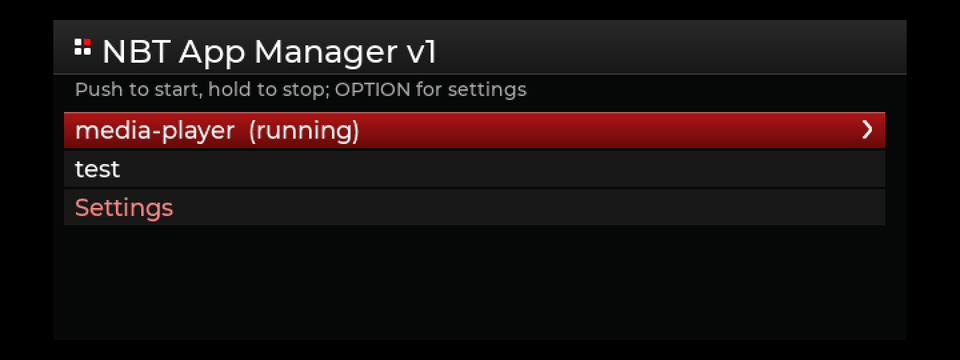
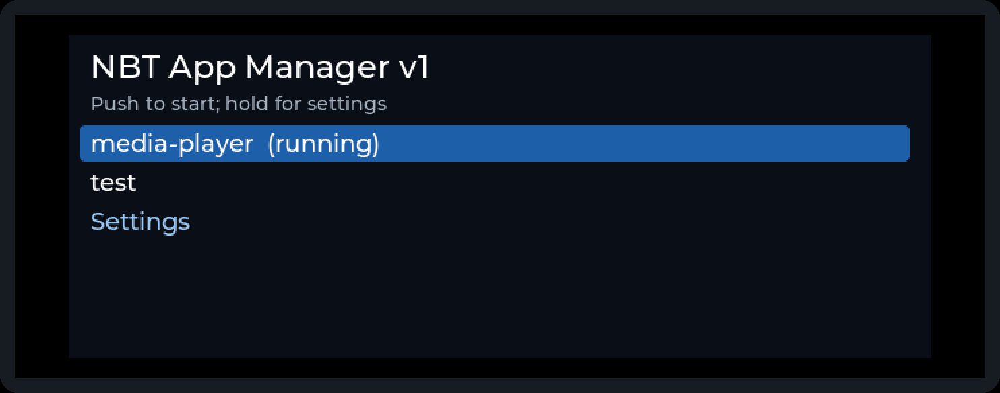
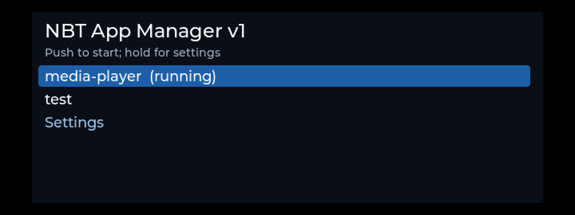
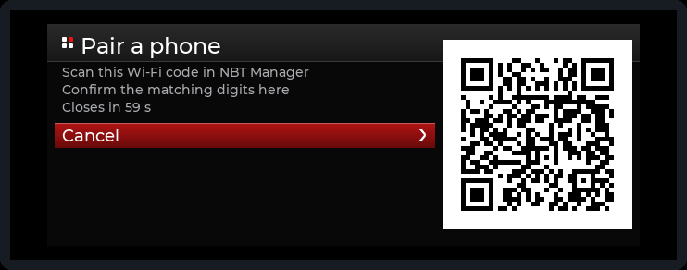
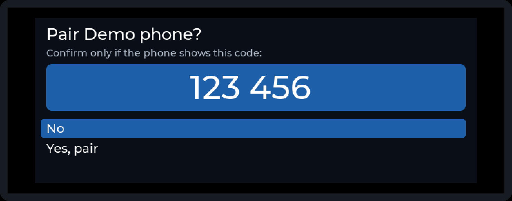
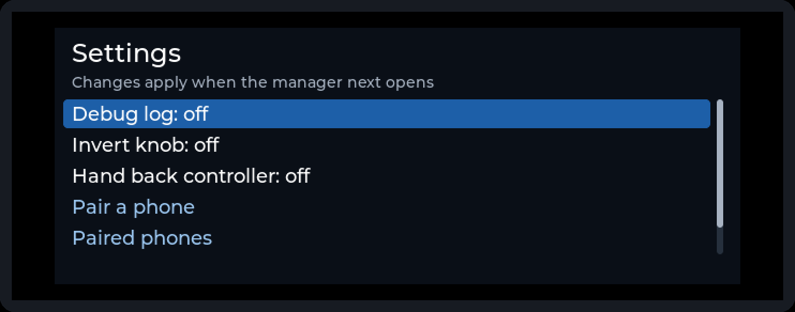
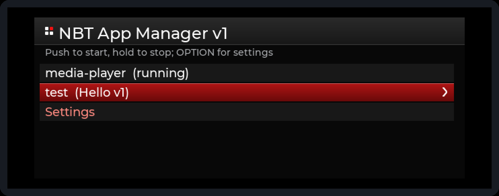
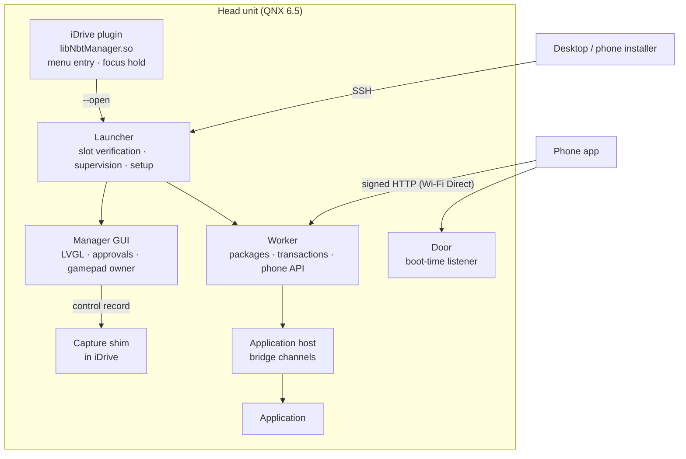

<!-- SPDX-License-Identifier: MPL-2.0 -->
<p align="center">
  <picture>
    <source media="(prefers-color-scheme: dark)" srcset="docs/assets/logo-dark.svg">
    
  </picture>
</p>

<h1 align="center">NBT Manager</h1>

> **Warning: installing or modifying this software can brick your head unit. Recovery may require professional service or replacement, at your expense. Provided AS IS; use at your own risk, subject to applicable law.** [Read the risk and liability disclaimer](DISCLAIMER.md).

<p align="center">
  <b>Your own applications on the iDrive screen.</b><br>
  Sent from your phone, approved on the car, rolled back if they fail.
</p>

<p align="center">
  
</p>

An application manager for BMW head units: it installs, updates, runs and removes
signed third-party applications on the car's own screen, launched from the iDrive
menu and driven with the iDrive controller or a USB gamepad. Applications are
added from a paired phone or the desktop installer, and every install is
confirmed by the driver on the car.

**Supported head units:** BMW NBT Evo (iDrive 6, QNX 6.5 on ARMv7). Support for
the earlier NBT may come later.

Part of [NBTFoundry](https://github.com/NBTFoundry):
[mobile-app](https://github.com/NBTFoundry/mobile-app) (phone app) ·
[installer](https://github.com/NBTFoundry/installer) (desktop installer) ·
[sdk](https://github.com/NBTFoundry/sdk) (application SDK) ·
[nf-doom](https://github.com/NBTFoundry/nf-doom) (example application)

Not affiliated with or endorsed by BMW AG. BMW, iDrive and NBT are trademarks of
BMW AG.

## What it does

- **Applications on the car's screen.** An "App Manager" entry in iDrive opens
  the manager's own screen (LVGL); applications start from it and get the panel,
  the iDrive controller and the car's audio, then hand them back.
- **Install from a phone.** Pair a phone once (six digits, confirmed on the car);
  then send packages, update or uninstall applications and change their settings
  from the NBT Manager app. The car verifies every package and asks the driver.
- **Signed and recoverable.** Packages and manager releases are RSA-3072 signed;
  updates run a health check and roll back to the known-good version when it
  fails. Every write goes through one path policy under `/var/opt/nbt-manager`.
- **An application bridge.** Applications get a small, versioned interface to the
  car: bring to front, a status line in the menu, live settings, MOST messages
  under a signed policy, the decoded iDrive controller and a wired USB gamepad
  ([docs/app-bridge.md](docs/app-bridge.md)).
- **Input capture.** While the manager or an application is shown, iDrive does
  not act on the controller ([docs/input-capture.md](docs/input-capture.md)).
- **Start with the car.** Each application's settings offer to start it about
  25 s after the head unit boots, without opening the manager; repeated
  failed starts pause that until it is started by hand.
- **Diagnostics.** A per-application log and a debug log, readable from the
  phone, and a Settings → Status page with a live gamepad test.
- **Languages.** English, French, German, Italian, Spanish, Chinese
  (Simplified) and Japanese. Automatic follows iDrive's language, English
  for any other; Settings → Language chooses one. Texts are in
  `src/gui/text/` and the fonts in `src/gui/fonts/` (PROTOCOL.md, "Manager
  GUI controller").

## On the car

<table>
  <tr>
    <td width="50%"><br>
      <sub>The menu, opened from iDrive: push to start, hold for settings</sub></td>
    <td width="50%"><br>
      <sub>Hold the push on an application to open its settings</sub></td>
  </tr>
  <tr>
    <td><br>
      <sub>Pairing: the phone app scans the car's Wi-Fi code…</sub></td>
    <td><br>
      <sub>…and the driver confirms the six digits the phone shows</sub></td>
  </tr>
  <tr>
    <td><br>
      <sub>The manager's own settings</sub></td>
    <td><br>
      <sub>An application on the panel (the test application)</sub></td>
  </tr>
</table>

Screens come from the GUI simulator, framed as the head unit's 1440×540 panel;
`make simulator && python3 tools/capture_ui.py` renders them again.

## How it fits together



| Component | Source | Role |
| --- | --- | --- |
| iDrive plugin | `plugin/` | The menu entry, iDrive's focus hold, the 60 s shim check, the debug log of the capture shim |
| Launcher | `apps/manager/launcher.cpp`, `src/launcher/` | Verifies the active slot, starts and supervises the worker and GUI, installs and updates the manager |
| Worker | `apps/managerd/`, `src/worker/` | Package verification, installs, updates, uninstalls, settings, the paired-phone API |
| GUI | `src/gui/` | The manager's screen, local approvals, pairing, the USB gamepad |
| Application host | `src/process/` | Starts an application with its bridge channels, log and limits |
| Capture shim | `src/capture/` | Keeps the controller from iDrive while the manager is shown |

## Build and test

Host requirements: a C++11 compiler, a C99 compiler for LVGL, OpenSSL development
libraries, Python 3 and the `openssl` command. LVGL 9.6 is a submodule:

```sh
git submodule update --init
nice make -j"$(nproc)" test        # host tools and all host tests
```

The tests generate temporary signing keys. Optional QR tests use `segno`,
`zxing-cpp` and Pillow when installed; socket tests are skipped where local sockets
are not allowed. Sanitizers and fuzzing:

```sh
NBT_TEST_ASAN=1 ASAN_OPTIONS=detect_leaks=0 nice make -j"$(nproc)" BUILD_DIR=build/asan \
  CFLAGS='-O1 -g -fsanitize=address,undefined -fno-omit-frame-pointer -fno-pie' \
  CXXFLAGS='-O1 -g -fsanitize=address,undefined -fno-omit-frame-pointer -fno-pie' \
  LDFLAGS='-fsanitize=address,undefined -no-pie' test
make fuzz FUZZ_SECONDS=5
```

Instrumented builds omit the child data limit so ASan can reserve its shadow
mapping; ordinary builds keep and verify the 256 MiB limit. `make pre-commit`
runs the format, line-limit, C++ rule and static-initializer checks.

**Simulator.** `make run-simulator` (`SCALE=3` to enlarge) opens an X11 preview
of the manager's GUI: the real GUI controller and LVGL renderer against a
simulated worker with two applications. Up/Down to move, Enter to select (hold it
on an application for its settings), Backspace or Escape to go back, M for MENU,
U to simulate a phone's pairing request or upload, Q to quit. It installs nothing
and opens no network session. `NBT_LANGUAGE=fr` (or `auto`, `en`, `de`, `it`,
`es`, `zh`, `ja`) sets the language and `NBT_SIM_CAR_LANGUAGE=13` iDrive's;
`python3 tools/capture_ui.py --languages --out <dir>` renders the main screens
in every language.

**Texts and fonts.** The GUI's texts are `src/gui/text/<code>.txt`, English
defining the keys; `python3 tools/gui_text.py` turns them into
`src/gui/text_tables.cpp`, and the fonts hold only the Chinese and Japanese
characters they use (`src/gui/fonts/README.md`, `tools/make_fonts.py`).
`tests/test_gui_text.py` fails when either is out of date.

**Head unit.** Source the QNX 6.5 SDP environment and point at local copies of
the head unit's Screen and framework libraries:

```sh
make qnx qnx-plugin qnx-capture qnx-check \
  QNX_SCREEN_LIBDIR=/path/to/screen/lib RHMI_LIBDIR=/path/to/framework/lib
```

This builds the worker, launcher, GUI, test applications, the iDrive plugin and
its resources (`build/NbtManager/`) and the capture shim. `qnx-check` verifies the
binaries' dynamic dependencies and that every imported C++ symbol exists in QNX
6.5's `libstdc++` (it uses `$QNX_TARGET`'s copy). Shipped binaries are stripped;
the unstripped links stay in `build/qnx-unstripped/`.

**Release.** A manager release is signed with the manager key:

```sh
make release \
  QNX_SCREEN_LIBDIR=… RHMI_LIBDIR=… \
  MANAGER_VERSION=v1 MANAGER_SEQUENCE=1 MANAGER_COMPAT=your-target-id \
  MANAGER_SIGNING_KEY=/secure/manager-private.pem \
  MANAGER_PUBLIC_KEY=/secure/manager-public.pem \
  APPS_PUBLIC_KEY=/secure/apps-public.pem
make installer-release   # the desktop installer with dist/manager.nbtr embedded
```

`dist/manager.nbtr` is the release; `installer-release` builds
`NBTFoundry/installer` (`NBT_INSTALLER_DIR`, default `../installer`). Increase the
sequence for every release. `BUILD_DIR` holds intermediate output (`make clean`
removes it) and `DIST_DIR` (default `dist`) the files ready to ship.

**Test kit.** `make kit` builds a Windows test kit from a clean commit
([docs/install-flow.md](docs/install-flow.md#kits)): the installer with the
release and a test application embedded, the phone app, test packages for the
phone and the in-car procedure. Signing keys for test kits are created on first
use in `~/.local/share/nbt-manager/keys` (`NBT_KEYS_DIR`).

## Applications

An application is one signed executable for one compatibility target; the
destination comes from its application id under the path policy, never from the
package.

```sh
python3 tools/package.py --app test --compat demo-1 --version v1 --sequence 1 \
  --key apps-private.pem --output test-v1.nbt build/test-v1-qnx
build/nbt-verify test-v1.nbt apps-public.pem test demo-1
```

`--setting 'background|Background color|blue|blue,red,green,black'` declares a
setting; `--bridge`, `--bridge-uses` and `--bridge-optional` declare bridge
capabilities ([PROTOCOL.md](PROTOCOL.md)), `--bridge-files` the files an
application accepts ([docs/files-bridge.md](docs/files-bridge.md)). Sequences must increase; an older
signed release needs the explicit recovery operation. Applications built with
`NBTFoundry/sdk` get the lifecycle contract, bridge channels, display and audio.

The test application shows "Hello world" on its configured background, publishes
a status label and exits on BACK or MENU. An application is uninstalled from its
settings in the manager (hold its name), or from a paired phone with confirmation
on the car; its executable, keys, state and data are removed, never following a
link.

## Trust and storage

- **Two keys.** The manager key signs manager releases only. One apps key signs
  every application package; its public half is compiled into the manager, so a
  manager release's signature covers it. Private keys stay on the signing
  workstation.
- **Local approval.** Installs, updates, uninstalls and pairing are approved on the
  car, bound to the verified package digest; no HTTP route approves anything.
  Paired phones sign every request with a P-256 key kept in the phone's Keystore
  ([docs/phone-access.md](docs/phone-access.md)).
- **Path policy.** Everything lives under `/var/opt/nbt-manager`; the policy checks
  the root's ownership and device, private parent directories, file types and link
  counts, and journal records never supply paths. QNX 6.5 lacks the
  directory-relative calls needed to close every race against a hostile process
  of the same user, so other processes of that user are trusted.
- **Applications' files.** Files the user brings for an application (capability
  `files`) are the one thing outside it: `/mnt/share/nbt-manager` on the hard
  disk, too large for the 492 MB `/var` partition, under the same ownership,
  device and link checks, bounded by each package's signed policy
  ([docs/files-bridge.md](docs/files-bridge.md)).
- **Health checks and rollback.** A new application or manager version must show
  readiness and 10 seconds of heartbeats; otherwise the previous one is restored.
  The launcher supervises the worker and GUI with bounded restarts and persisted
  restart counts; a failing manager candidate returns to the known-good slot.
- **Network.** Local HTTP on the car's Wi-Fi Direct group is unencrypted, which is
  why packages are signed and approvals are local. While a session listens, the
  worker adds one packet-filter rule for its port through `/dev/pf` (label
  `nbt-manager`; the door's is `nbt-door`) and removes it afterwards;
  `/etc/pf.conf` is never written.
- **Debug log.** While `/var/opt/nbt-manager/manager/debug.log` exists (128 KiB,
  one rotated copy) the GUI, worker and plugin log screens, input, sessions and
  installs; never signatures, nonces, Wi-Fi passphrases or package contents.

## Documentation

| Document | Contents |
| --- | --- |
| [PROTOCOL.md](PROTOCOL.md) | Control channel, application contract, settings, paired-phone HTTP protocol |
| [docs/app-bridge.md](docs/app-bridge.md) | The application bridge: capabilities, versioning, life of an application |
| [docs/bridge-design.md](docs/bridge-design.md) | Designs beyond bridge 1.4: car data, focus hold, autostart, favourite entry |
| [docs/most-bridge.md](docs/most-bridge.md) | MOST messages for applications, under a signed policy |
| [docs/gamepad-bridge.md](docs/gamepad-bridge.md) | Wired USB gamepads |
| [docs/controller-input.md](docs/controller-input.md) | The iDrive controller and iDrive's focus hold |
| [docs/input-capture.md](docs/input-capture.md) | The capture shim inside iDrive |
| [docs/hmi-restart.md](docs/hmi-restart.md) | iDrive's start and how the shim is loaded and kept |
| [docs/install-flow.md](docs/install-flow.md) | Installing and updating the manager; the launcher; recovery |
| [docs/manager-release.md](docs/manager-release.md) | Release format, slots and updates |
| [docs/phone-access.md](docs/phone-access.md) | Pairing and signed phone requests |
| [docs/android-auto-wifi.md](docs/android-auto-wifi.md) | Sharing the car's Wi-Fi with wireless Android Auto |
| [docs/head-unit-interfaces.md](docs/head-unit-interfaces.md) | MOST, the PluginApp framework and car data in the firmware |
| [docs/most-params.md](docs/most-params.md) | Reviewed MOST parameter layouts |
| [docs/car-inventory.md](docs/car-inventory.md) | Copying the head unit's files for study |
| [docs/car-diagnostics.md](docs/car-diagnostics.md) | Dumps, the watchdog, storage and tools on the head unit |
| [docs/bench-checklist.md](docs/bench-checklist.md) | Ordered validation on a bench unit |
| [docs/in-car-procedure.md](docs/in-car-procedure.md) | The in-car test procedure for a test kit |
| [plugin/README.md](plugin/README.md) | The iDrive plugin: launch contract and ABI |

## License

Copyright (c) 2026 Fabien Poussin. Original code, tests, build scripts and documentation are licensed under **MPL-2.0**; see [LICENSE](LICENSE).

Original NBTFoundry logos, artwork and screenshots are under **MPL-2.0**, including copies in other NBTFoundry repositories. Third-party code, fonts, game data and their notices retain their own terms. Copyright permission for artwork does not grant trademark rights or imply endorsement by BMW AG or id Software.

See [legal/README.md](legal/README.md) for third-party license notices.
