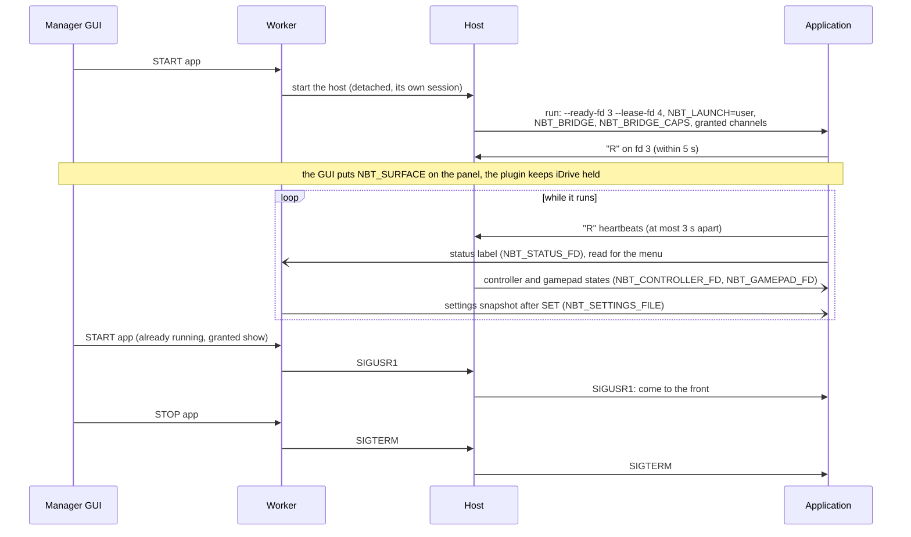
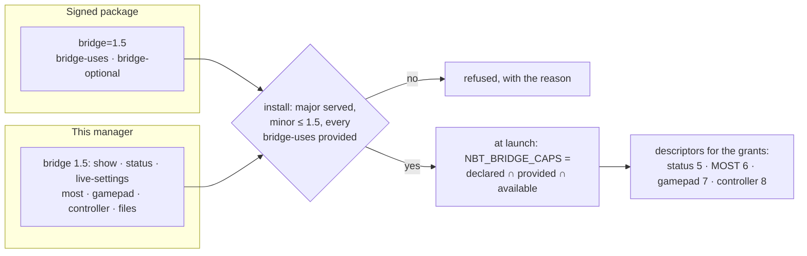

<!-- SPDX-License-Identifier: MPL-2.0 -->
# The bridge: car interface for applications

The bridge is the documented interface between managed applications and the
car. Applications use only this interface; the manager (its iDrive plugin,
worker and hosts) is its one implementation and the only code that talks to
iDrive, car data and the BMW plugin ABI. When a firmware needs different
plugin code, the manager changes and applications do not.

Managed applications ship no iDrive plugin of their own: the manager's menu
starts them, the controller's OPTION key opens their settings, and holding
the push on a running one stops it. Capabilities give an application more: coming to the front on request,
a status label in the menu, live settings, MOST messages under a signed policy,
a wired USB gamepad, the decoded iDrive controller and a folder of files.

The current provider is **bridge 1.5 with
`show,status,live-settings,most,gamepad,controller,files`**. Applications on the SDK
(`NBTFoundry/sdk`) get the application side of every capability.

| Capability | Since | Section |
| --- | --- | --- |
| `show` (bring to front) | 1.0 | [1](#1-bring-to-front-capability-show) |
| `status` (menu label) | 1.0 | [2](#2-status-line-capability-status) |
| `live-settings` | 1.0 | [3](#3-settings-for-larger-applications-live-settings) |
| `most` (MOST messages under a signed policy) | 1.1, `sub` rules 1.2 | [most-bridge.md](most-bridge.md) |
| `gamepad` (wired USB gamepad) | 1.3 | [gamepad-bridge.md](gamepad-bridge.md) |
| `controller` (decoded iDrive controller) | 1.4 | [4](#4-controller-input-capability-controller-bridge-14) |
| `files` (a folder of the user's files) | 1.5 | [files-bridge.md](files-bridge.md) |
| `hold` (iDrive held behind the application) | 1.6 | [5](#5-focus-hold-capability-hold-bridge-16) |
| `car-data` (iDrive car data) | 1.6 | [6](#6-car-data-capability-car-data-bridge-16) |
| `net` (packet-filter rules) | 1.6 | [7](#7-network-capability-net-bridge-16) |
| `runner` (built without the QNX SDP) | 1.7 | [8](#8-applications-built-without-the-qnx-sdp-capability-runner-bridge-17) |

A favourite entry is designed in [bridge-design.md](bridge-design.md); no bridge
version provides it yet.

Capabilities are host-tested (signed requirements, dependency checks, durable
records, launch grants, `SIGUSR1` show requests, live menu labels through
detached hosts) and cross-built for QNX; the parts that run inside iDrive are
checked on the car with [bench-checklist.md](bench-checklist.md).

## An application's life





## The interface at a glance

What an application sees. This table is the contract; the sections below say
how the manager provides each part.

| Part | Direction | Form |
| --- | --- | --- |
| Lifecycle | manager -> app | `--ready-fd 3 --lease-fd 4`, readiness and heartbeats (`PROTOCOL.md`) |
| Launch mode | manager -> app | `NBT_LAUNCH=user` or `check` |
| Settings | manager -> app | `NBT_SETTING_<KEY>`; `NBT_SETTINGS_FILE`, re-readable (3) |
| Data directory | manager -> app | `NBT_DATA_DIR` (3) |
| Interface version and grants | manager -> app | `NBT_BRIDGE=<major>.<minor>`, `NBT_BRIDGE_CAPS=<granted capabilities>` |
| Bring to front | manager -> app | `SIGUSR1` (1) |
| Window on the car | manager -> app | `NBT_SURFACE=1291` for `show`: bind the panel-sized window to it (1) |
| Status line | app -> manager | `NBT_STATUS_FD=5`, the file `/dev/shmem/nbt-bridge1-<app>.status` (2) |
| MOST | car <-> app | `most`: datagram socket `NBT_MOST_FD=6`, functions limited by the signed `bridge-most` policy ([most-bridge.md](most-bridge.md)) |
| Gamepad | car -> app | `gamepad`: states on `NBT_GAMEPAD_FD=7` ([gamepad-bridge.md](gamepad-bridge.md)) |
| Controller input | car -> app | `controller`: decoded states on `NBT_CONTROLLER_FD=8` (4); raw messages remain possible through `most` |
| Files | user -> app | `files`: the folder `NBT_FILES_DIR`, filled from the phone or a USB stick under the signed `bridge-files` policy ([files-bridge.md](files-bridge.md)) |
| Focus hold | app <-> manager | `hold` (1.6): requests on `NBT_HOLD_FD=9`, answers in the file `NBT_HOLD_STATE` (5) |
| Car data | car -> app | `car-data` (1.6): the iDrive car data named in the signed `bridge-cds` list, one file per name in `NBT_CDS_DIR` (6) |
| Network | phone -> app | `net` (1.6): the signed `bridge-net` rules let in through the packet filter while it runs; `NBT_NET` (7) |
| Runner | manager -> app | `runner` (1.7): a payload with the SDK's NBT ABI note runs under the release's `nbt-runner` (8) |
| Audio connection | manager -> app | `NBT_AUDIO_CONN=0x1d0` and `NBT_AUDIO_A2I=input_stereo_0` for a user launch while the manager's `native_audio` setting is `media` (PROTOCOL.md, "Manager settings"); no capability: an application that plays sound builds that connection instead of its default and plays into that io-amp input (the SDK's audio route and audio output do) |

Every name, path and format here belongs to one interface version; see
"Versioning and dependencies".

## Versioning and dependencies

The bridge has its own version, `<major>.<minor>`, independent of the
manager's release version. Applications depend on the bridge, never on a
manager release.

- **Minor** changes only add: a capability, a car-data field, an optional
  line or value. An application built for 1.2 runs unchanged on a manager
  serving 1.5, unless that manager no longer runs minors that old.
- **The oldest minor** a manager runs is part of its worker
  (`NBT_BRIDGE_OLDEST_MINOR` in `include/nbt/bridge.h`; 1.5 today). It is raised
  when applications built before some minor misbehave under the current manager:
  an application declaring an older minor is disabled until updated
  (PROTOCOL.md, "Disabled until updated"), never started. So declare the bridge
  version of the SDK you build with, not the lowest one that would do. An
  application declaring no bridge is not affected.
- **Major** changes anything else: a removed or renamed capability or
  field, a changed format or meaning, a changed signal. Each major has its
  own shared-memory names (`nbt-bridge1-...`, `nbt-bridge2-...`), so two
  majors can be served side by side.
- A manager serves the current major and the previous one for at least one
  release, so applications can be rebuilt in their own time. The GUI marks
  an application that uses a major due to be dropped.

What an application declares, in its signed package (manifest lines; a
worker without bridge support rejects them, so only packages that use the
bridge carry them):

```
bridge=1.2
bridge-uses=show,status,car-data
bridge-optional=hold
```

- `bridge`: the major it is built for and the lowest minor it needs.
- `bridge-uses`: capabilities it cannot run without.
- `bridge-optional`: capabilities it uses when present and copes without.

Checks, so a dependency is never broken silently:

- **Installing.** The worker checks the declaration when it verifies the
  package, before the review screen: the major must be served, the minor
  at most the manager's and at least the oldest it runs, every `bridge-uses`
  capability implemented. A failure is refused like a bad signature, with the
  reason ("needs bridge 1.3; this manager has 1.2", "declares bridge 1.4; this
  manager runs 1.5 and later"), on the phone page and the GUI. The accepted
  declaration is stored **inside** `state/<app>/installed` (see implementation
  notes below), so confirmation and recovery keep it with its executable.
- **Updating the manager.** A manager release lists the bridge versions and
  capabilities it serves. An update that drops a major or a required
  capability an installed application uses, or no longer runs the minor it
  declares, is not refused: the application is disabled until updated, shown
  as needing an update and never started, rather than left to crash. Staging
  names the first one it disables; recovery to an older release warns the same
  way. Updating the application, or going back to a manager that runs it,
  enables it again.
- **Running.** The host passes `NBT_BRIDGE=<major>.<minor>` (the version
  served for the application's major) and `NBT_BRIDGE_CAPS`: the declared
  capabilities that are both implemented and available on this car. A
  capability can be implemented but unavailable (for example car data
  that this firmware does not publish); a `bridge-uses` capability that is
  unavailable stops the start with "<app> needs <capability>, not available
  on this car".
- **Car side.** Firmware differences are the bridge's problem, not the
  application's: documented car-data fields keep their meaning across
  firmwares, and a field the car does not provide is absent, never
  repurposed.

Dependencies between applications (one using another's service) are not part
of the bridge.

## Versioning: formats and records

Application signing: `tools/package.py --bridge 1.5 --bridge-optional show`.
The three ordered fields appear after `sha256`, before any `setting=` lines.
When `bridge` is present, both capability fields are mandatory and may be empty.
Versions are canonical decimal `major.minor`, major 1-65535 and minor 0-65535
(no leading zeros). Each capability list is at most 255 ASCII bytes; names are
1-24 `[a-z0-9-]` characters beginning with a letter. Names are unique and
required/optional lists must not overlap. Unknown optional names are accepted
and omitted from grants. Unknown required names fail the implementation check.
The signed manifest remains bounded at 2048 bytes, including settings.

`src/model/bridge.cpp` provides the allocation-free parser, compatibility check
and intersection of declared, implemented and available capabilities. The C++11
API is in `include/nbt/model/bridge.hpp`; `src/model/bridge_api.cpp` retains the
C ABI, and `src/model/bridge_status.cpp` the status line's. The worker checks dependencies after signature verification and again at
installation. Reasons reach the existing GUI and phone status messages. The host
checks them before starting the application. Both user launches and candidate
health checks receive only `NBT_BRIDGE=<served major.minor>` and
`NBT_BRIDGE_CAPS=<grants>`; legacy applications receive neither variable. Of
the HMI's environment an application gets only NBT-AAD's `PATH` and, when set,
`LD_LIBRARY_PATH`, `LD_PRELOAD`, `GRAPHICS_ROOT` and `TZ`
(`nbt/process/hmi_environment.hpp`): without them the car's libraries and
tools (LayerManagerControl, the DSI client) do not load and the application
cannot reach the panel. An application's stdout and stderr go to its own
log, `state/<app>/output.log`, always (PROTOCOL.md, "Logs"). `show` and `status`
are gated by the child's readiness.
When the status channel cannot be created (an unsafe leftover, or
`/dev/shmem` refusing the checks), the host logs `no status channel` with
errno and starts the application without `NBT_STATUS_FD`: a label is not
worth the launch. The checker takes a separate list of the capabilities
available on the car, for capabilities that depend on it.

QNX applications using the C++ SDK compile with
`qcc -Vgcc_ntoarmv7le_gpp -lang-c++` and require the device's
`libstdc++.so.6`. Existing signed packages and the C ABI remain compatible.

**Persistence:** `NBTSTATE2` adds the three requirement fields to the installed
record after `sha256`. `NBTJ2` carries corresponding `old_`/`new_` fields in the
transaction journal. The candidate uses its journal declaration during health
checks. Confirmation and confirmed-crash recovery write the declaration with
the new record; unconfirmed recovery restores the executable with the old
record. A separate `state/<app>/bridge` file is deliberately not used: it could
otherwise lag behind the executable after a crash. A MOST policy makes them
`NBTSTATE3`/`NBTJ3`, a files policy `NBTSTATE4`/`NBTJ4`. `NBTSTATE1`/`NBTJ1` remain
valid for no-bridge applications; a successful update may remove a dependency.
The offline bundle tool also preserves signed bridge requirements.

Bridge 1.6 adds two more signed lines after `bridge-files`, each present
exactly when its capability is declared: `bridge-cds=<name>,...` (`car-data`,
1-16 dotted iDrive car-data names, `include/nbt/cds_policy.h`) and
`bridge-net=tcp:<port>@<interface>[+<interface>],...` (`net`, 1-4 ports on
`uap0` and/or `wfd0`, `include/nbt/net_policy.h`); `tools/package.py
--bridge-cds --bridge-net`. A record or journal with either is `NBTSTATE5`/`NBTJ5`
(a release before 1.6 refuses it rather than drop the policy).

Manager releases may contain up to two `bridge=<major>.<minor>|<capabilities>`
lines after `compat`, ordered by increasing major. The packager defaults to
`bridge=1.6|show,status,live-settings,most,gamepad,controller,files,hold,car-data,net` (`tools/bridge.py`); repeated `--bridge` overrides are for a publisher describing the
actual worker, and `--no-bridge` describes a legacy provider. Absent lines mean
no bridge. C++ and Rust verifiers enforce the same bounds and syntax.
The publisher must keep the metadata and `nbt_bridge_current()` implementation
in agreement; metadata does not enable capabilities in an executable. The lines
cannot state the oldest minor the worker runs (a new field would make older
launchers, installers and phones reject the release): `nbt_bridge_current()`
alone carries it.

Staging holds the manager operation lock and each installed application's
transaction lock until activation is durable. It refuses busy/interrupted apps
and unreadable records before clearing a slot, naming the affected app. A
dependency mismatch is not refused: the release disables that application until
it is updated, and staging writes a bounded `Disabled until updated: <app>:
<reason>` on stderr (`Recovery warning: ...` for explicit older-manager
recovery); invalid storage/records still fail closed. New app provisioning/updates are blocked while manager activation
is pending or on trial, preserving the dependency set checked at staging.
The stable launcher's provisioning code reads the **active signed release's**
provider rather than assuming its own compiled capabilities match the worker,
and adds the oldest minor from its own (outside a trial, the launcher is the
active release's). Packages and records without bridge lines remain valid.


## Principles

- **The plugin stays small** (`AGENTS.md`). It does only what needs the HMI
  process: holding focus, reading car data, its entries. Everything else
  stays in the worker and the GUI.
- **One generic bridge, not per-application code.** An application declares
  what it uses in its signed package; nothing in the plugin or worker names
  an application.
- **Declared, then granted**, against a version (above). Packages without
  bridge lines stay valid and get no bridge.
- **Everything crossing the bridge is untrusted.** Files in `/dev/shmem`
  can be written by any local process with the same user; parse them
  strictly, bound their size, and never let them grant more than the
  declared capabilities. QNX `/dev/shmem` has no `rename()`, so bridge
  files are written in place with a single `write()` of a whole
  line that carries a sequence number, and readers ignore lines that do not
  parse (as the existing `nbt-manager-hmi` signal file does).

## Components

### 1. Bring to front (capability `show`)

`START <app>` on a running application asks it to come to the front instead
of starting a second host:

- The worker finds the host's lifetime write lock on byte 0 of
  `state/<app>/host.lock`. A read lock on byte 1, owned by the same PID,
  advertises `show` only after its child is ready and has that grant.
  The worker rechecks the owner and sends it `SIGUSR1`. The host forwards
  from its main loop only to its own unreaped child, whose PID cannot have
  been recycled, and only while not stopping. The worker-to-host lookup uses
  the same POSIX lock-holder addressing as stop; this is not a portable
  pidfd guarantee against every host-exit/PID-reuse race.
- An application granted `hold` (bridge 1.6), which places its own surface,
  gets the same request: chosen again in the manager while it runs, it is
  asked to come back (Android Auto's adapter tells its daemon `show`). Its
  host advertises byte 1 as for `show`; no surface is granted.
- An application that declared neither is left alone (`SIGUSR1` would
  terminate it by default). `START` then answers `ERR running`, and the GUI
  says "<app> is already running" instead of closing. A host awaiting
  readiness answers the same way; a failed lookup answers `ERR start`.
- The app installs its `SIGUSR1` handler before readiness. Signal handlers
  only set flags; window operations run in its main loop. Requests may
  coalesce. `OK` acknowledges acceptance, not proven display success.
- Plain `RUNNING` returns names; `RUNNING status` also supplies valid status labels (component 2).

Implemented in `src/process/app_host.cpp`, `src/worker/worker.cpp`,
`src/worker/daemon.cpp`, `src/gui/ui_controller.cpp` and `apps/test/main.cpp`.
The test app reposts its existing Screen buffer and makes the window visible,
resetting its no-input hide timer; a health-check launch ignores show. This uses
the existing
[QNX Screen visibility API](https://www.qnx.com/developers/docs/6.5.0SP1.update/com.qnx.doc.screen/topic/screen_8h_1Screen_Property_Types.html).

On the car, LayerManagerService draws only windows bound to a numbered
surface (`head-unit-interfaces.md`), and nothing may cover iDrive unless
iDrive is held on an inert state (`controller-input.md`). So a user launch
granted `show` gets `NBT_SURFACE=1291`, the one application surface, held by
one host at a time (`PROTOCOL.md`); a second `show` application is refused
with "another app has the screen". The application binds a panel-sized window
to it (Screen id string; the SDK's `ScreenWindow::open(w, h, surface)` does
this) and never places it itself: the manager GUI that started it puts it on
the panel while the plugin keeps iDrive held, and takes it off. An
application cannot hide its window from the panel; the test app ends instead. Without `NBT_SURFACE` (host tests, a health check, the surface
taken) it runs undrawn on the car. An
application that shows itself without the manager (Android Auto when a phone
connects) needs the focus hold designed in [bridge-design.md](bridge-design.md).
The Windows kit's test packages require `show`. The simulator returns
`ERR running` for its media app (no grant) and supports showing its test app.
Host tests cover forwarding, grants, readiness, same-PID restarts, whole-file
lock rejection, GUI behavior, Screen restoration and health-check isolation.

### 2. Status line (capability `status`)

The host creates a fresh `/dev/shmem/nbt-bridge1-<app>.status` before each
user launch granted `status`. The application receives `NBT_STATUS_FD=5`;
write through that descriptor, not a caller-selected path. Candidate health
checks receive no status descriptor. The file contains one line
`<sequence> <text>`, the text at most 24 printable ASCII characters. While
it runs, the manager's main menu shows `<app>  (<text>)` instead of
"(running)". The worker reads it on the GUI's periodic `RUNNING status` request. Missing, stale (no
running host) or malformed: plain "(running)".

`nbt_bridge_status_format` formats a bounded line; `nbt_fs_status_write`
writes it at offset zero and truncates to its new length, with no rename or
fsync. Sequence is canonical uint64 decimal (zero allowed), text is 1-24
printable ASCII bytes. The sequence aids producers/readers; it cannot make
in-place writes atomic. Malformed/partial reads fall back and are retried.
The host's byte-3 readiness/grant marker gates reads; byte 2 stays free so it
cannot merge with the show marker. Missing, stopped, unready and ungranted
applications cannot supply a status label, and each new host resets old bytes.

The GUI requests `RUNNING status`, polling the menu once per second. The
worker reads/validates files and live-host markers; rendering remains I/O-free.
Plain `RUNNING` still returns names only. Status is untrusted display text,
never an authorization or health signal. Local apps share a UID and are not
isolated from one another.

### 3. Settings for larger applications (`live-settings`)

Since bridge **1.0**, with `show` and `status`.

- Applications may declare **12** choice settings, six choices each. The GUI
  parses two-digit counts and scrolls through all settings plus Stop. The
  signed manifest still has a **2048-byte** total limit: long declarations,
  identity fields and bridge lists must fit together. Package tooling rejects
  overflow before signing; older workers reject more than four settings.
- Provisioning creates private `data/<app>` and passes its validated absolute
  path as **`NBT_DATA_DIR`** on user and health-check launches. Offline bundles
  include the directory, signed schema and default snapshot too. Ordinary
  executable updates/recovery preserve app-owned data. Persistent non-choice
  values and advanced options belong there; `settings` is reserved for the
  manager. Existing data at provisioning is a conflict, never overwritten.
- `SET` saves the authoritative `state/<app>/settings` atomically, then writes
  all effective values to **`data/<app>/settings`** (`NBTVALUES1`) using one
  bounded write, truncate and sync, preserving its inode. Provisioning, schema
  confirmation and a live app's launch publish the snapshot too. The existing
  `NBT_SETTING_*` environment remains the startup contract.
- Apps granted **`live-settings`**, required or optional in their signed
  declaration, get **`NBT_SETTINGS_FILE`**. They re-read on demand; the reusable
  `src/sdk/settings_file.cpp` reader opens afresh, validates a bounded private
  regular file and applies allowed choices only after complete parsing. Failed
  reads leave the caller's defaults or last valid values unchanged. The test app
  refreshes its background colour once per heartbeat without restarting.
- The GUI asks `SETTINGS <app> live`, whose reply adds `live` or `restart`
  after the count, based on the installed declaration and provider grants.
  A live app's page says **"Changes apply at once"**. Plain `SETTINGS <app>`
  keeps its existing response. The simulator advertises live settings for test.

Durability and safety: snapshots are not atomic to concurrent readers. A read
may see a partial or mixed write; this is eventual settings delivery, not an
authorization channel. A failed save/snapshot sync returns `ERR settings`; a
late failure may already have saved the durable choice. Retrying `SET` or
restarting repairs the snapshot from authoritative values. An unsafe file or
directory alias is refused; symlinks, hard links, special files, wrong owners,
public snapshot permissions and filesystem changes cannot be write targets.
All manager mutations pass `src/storage/`. Settings writes serialize against app
startup/updates; the same worker rejects writes while holding its update lock
(POSIX locks belong to a process). Schema publication retains that update lock.

### 4. Controller input (capability `controller`, bridge 1.4)

The manager decodes the iDrive controller and the favourite keys once, in the
application's host, and hands the application the result: it never parses
MOST, needs no signed policy and sees nothing else of the bus.

- **Channel.** `NBT_CONTROLLER_FD=8`, a non-blocking Unix datagram socket,
  user launches only. One 16-byte little-endian state per datagram
  (`include/nbt/controller_wire.h`): sequence, keys held, rotation (detents
  clockwise since the feed started, wrapping) and whether the manager's MOST
  link is up.
- **Keys.** `PUSH`, `MENU`, `BACK`, `OPTION`, `COM`, `MEDIA`, `NAV`, `MAP`,
  the four tilts (a diagonal holds two) and `FAVOURITE(0..7)`. Hard key slots
  follow BMW's order (0 MENU, 1 BACK, 2 OPTION, 3 COM, 4 MEDIA, 5 NAV, 6 MAP;
  NBT-AAD's car-tested decoder); the older CCS controller (0xC10/0xC20) is
  decoded too. The favourite keys are FBlock 0x15 instance 0x0C function
  0xC02, one state byte per key (HmiMain3D's `CPxyCECenterStack`,
  [input-capture.md](input-capture.md)); the volume button next to them
  (0xC01) and the master volume (AudioMaster 0x20) are not part of the feed.
- **Reader.** `nbt::controller::Input` (`include/nbt/controller/input.hpp`,
  `src/sdk/controller_input.cpp`, portable C++11, no allocation): `poll(fd,
  deliver, context)` delivers each change as the state and an `Event` with
  the keys pressed and released and the detents turned. Keys count only once
  every key was seen up, so the push that started or resumed the application
  is never a press.
- **Who gets it.** Only an application that has a surface and is not paused
  (`HostChannels::spawned`, `pause`). Going quiet (paused, hidden) first sends
  a released, disconnected state, so nothing stays held. The host's one MOST
  client registers the controller instances and 0x15.0C as device
  controllers; an application that also has `most` keeps its own policy for
  the raw channel.
- **iDrive.** While the manager or the application is on screen, the active
  capture shim keeps these keys from iDrive (presses and releases alike).

`NBTFoundry/nf-doom` reads it through the SDK's reader (`src/input_idrive.cpp`).
Host tests: `tests/test_controller_feed.cpp` (decoder, wire, reader) and
`test_controller_states_reach_a_shown_application` in `tests/test_app_host.py`.
The favourite keys reach the manager when the MOST server delivers 0x15.0C.C02 to
a client registered for it, as it does to iDrive's own proxy; the debug log shows
the messages received.

### 5. Focus hold (capability `hold`, bridge 1.6)

For an application that places its own surface on the panel (Android Auto):
while it asks, iDrive is held on the plugin's inert state, as for the
manager's window, so the knob and the hard keys do not drive iDrive's menus
underneath ([bridge-design.md](bridge-design.md)).

- **Request.** A user launch granted `hold` gets `NBT_HOLD_FD=9`, a fresh
  private file of its host (`/dev/shmem/nbt-bridge1-<app>.hold`). The
  application rewrites one line there, `<sequence> hold|peek|release`
  (`include/nbt/bridge_hold.h`): `hold` while it is on screen, `peek` while
  iDrive's own favourites bar is shown over it (the hold stays, nothing is
  re-asserted), `release` when it leaves the screen.
- **Relay.** The host relays the request, once the child is ready, as
  `<its monotonic ms> <sequence> <app> <word>` in `/dev/shmem/nbt-bridge1-hmi`,
  refreshed every second; a line older than 3 s is a host that ended. The
  child's end relays `release`.
- **Answer.** The plugin (`AppHold`, `src/gui/hmi_hold.cpp`) holds as the
  entry does (event 52 to the parent, 50 to the blank state), holds again
  after BACK, and writes `<sequence> held|aside` to the file named by
  `NBT_HOLD_STATE` (`/dev/shmem/nbt-bridge1-<app>.hmi`). `aside` when iDrive
  leaves the blank state for 0.5 s (MENU, NAV, MEDIA, a warning, a camera),
  when the manager's window opens (it keeps priority) or another application
  holds: the application then leaves the screen, and only a new request (a
  new sequence) holds again. The 3 s stuck-focus guard drops it too.

### 6. Car data (capability `car-data`, bridge 1.6)

- **Declaration.** The signed `bridge-cds` list names the iDrive car-data
  properties the application reads (`driving.gear`, `sensors.PDCStatus`, ...;
  [car-data-properties.tsv](car-data-properties.tsv)).
- **Subscription.** While a granted application runs, its host keeps
  `/dev/shmem/nbt-bridge1-<app>.want`, `<ms> <names>`, refreshed every
  second. Every second the plugin (`plugin/car_data.cpp`) subscribes to the
  union of the fresh lists (at most 32 names; the plugin's own three are
  shared), unsubscribes the rest, and removes a value file before
  subscribing, so no value from an earlier run is read as current.
- **Values.** Each value the car gives, as text (UTF-16 to printable ASCII,
  at most 200 bytes, else left out and logged), is written to
  `<NBT_CDS_DIR>/nbt-bridge1-cds-<name>` as `<sequence> <value>`. Values are
  iDrive's own JSON (`{"gear":2}`); reading them is the application's job.

### 7. Network (capability `net`, bridge 1.6)

- **Declaration.** The signed `bridge-net` rules: TCP ports, each on the
  CarPlay hotspot (`uap0`) and/or the Wi-Fi Direct group (`wfd0`).
- **Rules.** Before a granted user launch the host inserts one rule per port
  and interface at the head of the running packet filter
  (`nbt_firewall_app_add`, label `nbt-app-<app>`, any destination address),
  removes them when the child ends, and removes its own leftovers first. The
  application gets `NBT_NET=<the rules>` only when all were opened (it may
  then leave the filter alone; NBT-AAD's `NBT_KEEP_PF=1`).
- **Wi-Fi Direct.** While it runs the host keeps
  `/dev/shmem/nbt-bridge1-<app>.net`; a fresh one with a `wfd0` rule keeps
  the group on when a phone session ends (`wifi_direct_controller.cpp`), as
  standalone NBT-AAD's own setting does.

### 8. Applications built without the QNX SDP (capability `runner`, bridge 1.7)

- **Payload.** A module (ARM `ET_DYN`) or a guest (ARM `ET_EXEC`) built with
  the SDK's open toolchain, carrying its NBT ABI note (`.note.nbt`: ABI major,
  minor, mode; the SDK's `docs/native-apps.md`). No QNX file is in it.
- **Declaration.** `bridge=1.7` and `runner` in `bridge-uses`, never optional:
  without the runner the payload cannot run, so a manager that lacks it
  refuses the package ("needs bridge 1.7"). `tools/package.py` requires the
  declaration exactly when the payload has the note, with the note's mode
  matching the ELF type.
- **Start.** The manager release carries `nbt-runner` (`NBTRLS3` component
  `runner`, staged as `manager/slots/<n>/runner`). For an installed payload
  with the note, the host and the worker's health check start the runner of
  their own slot instead of the payload, with the same descriptors,
  environment and limits, and the payload's path last:
  `runner --ready-fd 3 --lease-fd 4 --nbt-payload apps/<app>/bin/app`.
  The runner takes the bridge as any application and runs the module in its
  process or the guest as its child. A manager without a runner fails the
  start (`cannot start the application`).
- **Versions.** The runner refuses a payload built for another ABI major or a
  newer minor before running anything (`needs runtime X.Y; this runner has
  A.B` in the application log), so the install's health check fails cleanly.
  ABI minors only add host functions; a payload keeps working across manager
  updates.

## Design notes

- Shared-memory names are flat (`nbt-bridge1-...`), without subdirectories in
  `/dev/shmem`.
- Car-data names are checked with the framework's `cdsIsPropertyAvailable(name)`
  before subscribing ([head-unit-interfaces.md](head-unit-interfaces.md)).
- Files in `/dev/shmem` are rewritten in place with one `write()` of a short
  line; the sequence number lets a reader retry a torn read.
- The focus hold does not cover touch: iDrive still reacts to touches while
  another surface is shown.
- Hosts forward requests as `SIGUSR1`/`SIGUSR2`; a control pipe from the host
  would replace them if requests multiply.

## The manager's own car data

The manager itself reads two car-data names through its plugin,
`driving.speedActual` and `hmi.graphicalContext`, with change subscriptions plus
one-second asynchronous reads and bounded UTF-16 parsing, for the phone's wake
gate ([phone-access.md](phone-access.md)). Applications granted `car-data` that
name them get their values from the same subscriptions (component 6).
