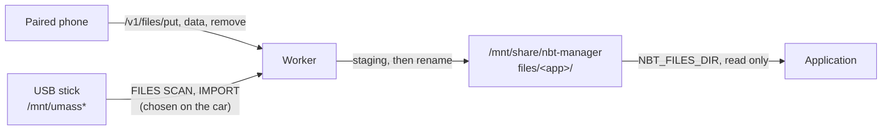

<!-- SPDX-License-Identifier: MPL-2.0 -->
# Applications' files bridge

Bridge capability `files` (bridge 1.5) gives an application a folder of files
the user brings to the car: from a paired phone, or from a USB stick chosen on
the car's screen. Nothing in it names an application or a file type: an
emulator's games, a player's music or a map viewer's tiles use it the same way.
The application only reads its folder; the manager alone writes it.



## Declaration

A package declaring `files`, required or optional, adds one signed line after
`bridge-most` (when there is one):

```
bridge=1.5
bridge-uses=show,controller,files
bridge-optional=status,live-settings,gamepad
bridge-files=sfc,smc,fig,swc|16|1024
```

`bridge-files=<extensions>|<largest file, MiB>|<quota, MiB>`: 1 to 16 unique
extensions of 1 to 8 `[a-z0-9]`, a largest file of 1 to 4096 MiB and a quota of
1 to 65536 MiB, at least the largest file. Numbers are canonical decimal. The
line is present exactly when `files` is declared, needs bridge 1.5 or later,
and a manager that does not serve `files` refuses the package (as for a MOST
policy). `tools/package.py --bridge-files` writes it after checking it as the
manager does (`src/model/files_policy.cpp`, `tools/bridge.py`). The policy is
part of the installed record (`NBTSTATE4`, `NBTJ4`): a manager release before
1.5 refuses such a record rather than lose the policy.

## Where the files are

The managed root (`/var/opt/nbt-manager`) is on a 492 MB partition, too small
for games or media, so files live on the head unit's hard disk:

```
/mnt/share/nbt-manager/             the files root (0700, the manager's)
  files/<app>/<name>                an application's files
  staging/<app>.phone, <app>.usb    a transfer in progress
```

`storage::FilesRoot` (`src/storage/files_root.cpp`) applies the managed root's
rules there: every directory the manager's own, private and on the root's
device, reached without links; every file regular, owned and with one link.
It creates the root when it is missing. A file arrives in a staging file
outside the application's folder, is synced, then renamed into place, so an
application never reads half a file. Uninstalling an application deletes its
folder and staging files first, still under its locks; with the disk
unavailable they stay, and a later install of the same application finds them.

A stored name is 1 to 96 printable ASCII bytes without `/ \ : * ? " < > |`,
not starting with a dot or a space, not ending with a dot or a space, with an
extension after its last dot; its extension, in any case, must be one the
application declared. At most 512 files per application, the declared quota,
and 256 MiB of the disk always left free.

## The application's side

A user launch granted `files` gets `NBT_FILES_DIR=/mnt/share/nbt-manager/files/<app>`.
The host checks the root before the start: when it cannot be used (no disk, an
unsafe folder), `files` is unavailable, so a required `files` refuses the start
with "<app> needs files; not available on this car" and an optional one is not
granted. The application lists and reads its folder; whatever it writes belongs
in `NBT_DATA_DIR` (saves, settings). The SDK's `nbt::app::FileList` lists the
folder with the same name rules.

## From a paired phone

Four signed routes, refused to the door listener. No prompt on the car: the
signed policy bounds what a file can be, and files are data, never run. The
phone app asks before it deletes. One transfer at a time, none while the worker
is busy (an install, a removal, a USB import) or the application is being
updated. Phone transfers carry at most 64 MiB, a package's limit; larger files
come by USB.

| Route | Body | Reply |
| --- | --- | --- |
| `POST /v1/files/list` | `app\t<after>\n` | `FILES\t<count>\t<used>\t<quota>\t<largest>\t<free>\t<more>\t<ext,...>\n`, then up to 20 `name\tsize\n` named after `<after>` (empty: from the first), in byte order |
| `POST /v1/files/put` | `app\tname\tsize\tsha256\n` | `OK\n`: the name, size and space are accepted, and the phone holds a 60-second ticket |
| `POST /v1/files/data` | the file, `application/octet-stream` | `OK\n` once stored; only from the ticket's phone, of the announced size; its SHA-256, which the request's signature covers, must be the announced one |
| `POST /v1/files/remove` | `app\tname\n` | `OK\n`, deleted at once |

Refusals are `ERR <reason>\n`: `request` (400), `app` (404: not installed, or
no `files`), `type` and `name` (400), `size`, `phone-size`, `quota`, `count`
and `space` (413), `missing` (404), `busy` (409), `digest` (400, the bytes are
not the ones announced) and `unavailable` (503, the disk). A data request
without a valid ticket is refused before its body (403). Sizes and the quota
are bytes; `<free>` is what the disk can still take.

## From a USB stick, on the car

An application's settings page offers **Files** when it is granted `files`
(`SETTINGS <app> live` answers `live+files` or `restart+files`). It lists the
stored files with their usage, deletes one after a No/Yes, and **Import from a
USB stick** scans the sticks and lists what matches: **Import all**, or one
file. The worker does the work on its job thread (`src/worker/usb_files.cpp`),
so the GUI polls its progress once a second and other installs wait.

- Sticks are the `/mnt/umass*` folders (QNX's mass-storage mounts), walked to
  a depth of 4 below the stick, at most 4096 entries in all and 64 matches,
  without following links or entering hidden folders.
- A file matches when its name, made a valid stored name (bytes it may not
  hold become `_`; a long name keeps its extension), has an accepted
  extension. Two files made the same name replace each other.
- Each file is admitted (type, size, quota, count, space) and copied as a
  phone's file is. A full quota, disk or file count ends the import; a file
  that changed on the stick or cannot be read is skipped.

The GUI's commands are in PROTOCOL.md, "Applications' files".

## The gamepad's family (bridge 1.5)

Bridge 1.5 also tells an application which pad is plugged in: byte 3 of the
gamepad state ([gamepad-bridge.md](gamepad-bridge.md)) carries its family, so
an application can lay out its controls for that pad and name its buttons.

## Checks on the car

See [bench-checklist.md](bench-checklist.md), "Applications' files": that
`/mnt/share` is writable, persistent and safe for the manager's folder, that
sticks mount as `/mnt/umass*` while a gamepad is plugged in, and that a large
import neither starves the GUI nor trips iDrive's watchdog.
