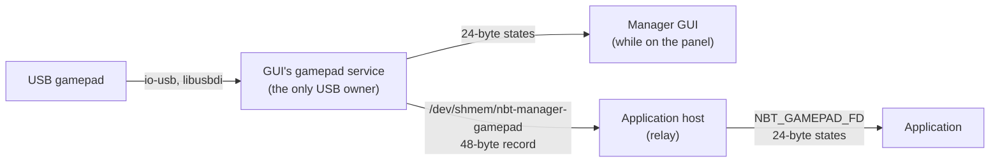

# Wired USB gamepad bridge

Bridge capability `gamepad` (bridge 1.3 and later) gives the application on screen
the state of one wired USB gamepad. It changes no package, installed-record or
journal format. Applications may keep minimum bridge 1.2 and request `gamepad`
as optional; unknown optional capabilities stay compatible with older managers.
A required capability needs an implemented service; an unplugged controller is
an ordinary disconnected state. Applications never choose a USB path or send USB
commands.

## Channel

`NBT_GAMEPAD_FD=7` is a non-blocking `AF_UNIX`/`SOCK_DGRAM` socket, passed only to
user launches that declared and were granted `gamepad` (MOST is 6, status 5).
Both launch implementations keep it through descriptor mapping and sandbox
set-up. Health checks get no gamepad descriptor. Applications cannot send
commands on it; anything they write is discarded in bounded batches. No HTTP or
plugin route can generate gamepad input.

Every datagram is exactly 24 bytes, little-endian:

| Offset | Field |
| --- | --- |
| 0 | Version, 1 |
| 1 | Type, 1 (complete state) |
| 2 | Connected, 0 or 1 |
| 3 | Reserved, zero |
| 4 | Unsigned 32-bit sequence, modulo 2^32 |
| 8 | Unsigned 32-bit buttons |
| 12, 14, 16, 18 | Signed 16-bit left X/Y, right X/Y |
| 20, 22 | Unsigned 16-bit left/right trigger |

Stick axes span -32768..32767, positive right and up. Triggers span 0..65535.
Button bits 0–14 are south, east, west, north, LB, RB, View, Menu, left and right
stick clicks, Guide, D-pad up, down, left and right; other bits are rejected. A
disconnected state has neutral controls. Changes are sent at once and the
complete state repeats every 100 ms. Socket back-pressure never blocks USB or the
UI; the latest state goes out with the next snapshot.

The application-side reader (`include/nbt/gamepad/input.hpp`,
`src/sdk/gamepad_input.cpp`, shared with `NBTFoundry/sdk`) has no manager or USB
dependency. It rejects short, oversized and malformed datagrams, ignores stale or
repeated sequences, clears the controls after 500 ms without a valid state, and
requires neutral controls after a connection or focus change. Applications keep
their own button edges; a disconnected state cancels a selection, never confirms
it.

## Ownership and relay

The manager GUI owns the USB pad for its whole life; it keeps running, hidden,
while an application is shown, so the pad is never closed and reopened at a
switch. The GUI's service (`src/gamepad/service.cpp`):

- keeps the pad open and sends each state to the GUI's own socket, used only while
  the manager is on the panel;
- publishes it in `/dev/shmem/nbt-manager-gamepad` (`src/gamepad/shared_state.cpp`):
  one 48-byte record of magic, count, monotonic time, the 24-byte wire state and
  the count again, rewritten at least every 100 ms, with the same owner and mode
  checks as the capture control file.

An application's host relays the record (`src/gamepad/relay.cpp`) on
`NBT_GAMEPAD_FD` unchanged, on change and at least every 100 ms. The pad counts as
connected only while the host is active (a surface, not paused) and the
application's surface holds the panel (checked every 250 ms). A torn, malformed
or stale record (older than 500 ms: the GUI is gone) is sent as disconnected.
Hosts never open USB.

Byte 0 of `state/manager/gamepad.lock` makes one process the owner: a second GUI
waits, and the owner's death releases it. USB buffers are freed before the
disconnect that destroys the DDK allocator; unexpected USB clean-up errors end the
owner.

## USB service

Only one controller is active. The first supported arrival is kept until it is
removed; other supported pads wait. A pad that fails to open is retried after 2 s,
doubling up to 60 s, and is told apart from other pads on its port by vendor and
product. USB work runs on the service thread with asynchronous interrupt input and
bounded, timed output; the GUI and host loops never attach or transfer.

**Library.** At its first connection the service loads the head unit's
`/lib/libusbdi.so.2` with `dlopen` and uses it when all 20 entry points it calls
resolve; otherwise it uses the QNX SDK's static `libusbdi.a`, linked in
(`src/gamepad/usbdi.cpp`). No `DT_NEEDED` entry is added, so a missing or different
library cannot stop the manager from starting. The log names the library used.
Both connections use libusbdi's default path. The USB stack's node is
`/dev/io-usb/io-usb` on the head unit (root-owned, mode 0644); the service looks
at `/dev/io-usb` too.

**Discovery and attachment.** A short descriptor-only (shared) connection reads
the device's interfaces one by one (`usbd_interface_descriptor`, configurations 1
to 4, interfaces 0 to 15), logging each as
`gamepad: USB vvvv:pppp config C interface I class cc/ss/pp`, with a
`usbd_parse_descriptors` walk as a fallback. The shared attachment is closed before
the exclusive one, since a shared/exclusive conflict can return `EBUSY`. Xbox uses
data interface 0 (its three interfaces share class `ff/47/d0`, so the class alone
cannot choose); Sony uses the HID interface (`03/00/00`, after the DualShock's
audio interfaces). Endpoints come from the descriptors at run time.

**Configuration.** The current configuration is read with a synchronous
`GET_CONFIGURATION`; a matching configuration is kept, an unconfigured device is
configured once, and an unexpected active configuration is rejected (re-selecting
a configuration would reset every interface of a composite device). The selected
interface uses alternate setting 0, without requiring `SET_INTERFACE(0)` to
succeed. Control requests are synchronous (`usbd_io`); requests with a completion
callback do not complete on the head unit. For Sony pads a best-effort `SET_IDLE`
(report 0, duration 0) is sent, without changing the HID protocol or enabling
optional features, and the DualShock 4's light bar is set to blue once with
output report `0x05`; a failed write only logs.

**Teardown.** Submission stops, transfers are aborted and drained, the device is
detached, USB allocations are freed, then the last connection is closed:
`usbd_detach` returns `EBUSY` while I/O is pending, and `usbd_disconnect` destroys
the allocator pools when the connection count reaches zero.

**The head unit's media launcher** (`vdev-medialaunch`) sends every new USB
device an Apple-accessory request and resets devices that fail it; a pad can
disappear about 2 s after insertion and be reported again when the service
attaches anew. No configuration reset is ever issued to unrelated USB devices.

Every step that can stop the service logs it with its errno
(`gamepad: <step> failed (errno N)`); a start logs
`gamepad: service ready for the GUI` and the library in use, and every device
io-usb reports is logged at connection.

## Controllers

| Family | Devices | Interface |
| --- | --- | --- |
| Xbox One (GIP) | Microsoft `045e:02d1` (original), `02dd` (2015), `02e3` (Elite Series 1), `02ea` (One S), `0b00` (Elite Series 2), `0b0a` (Adaptive), `0b12` (Series X\|S), and compatible GIP pads | interface 0, class `ff/47/d0`, interrupt IN and OUT |
| DualShock 4 | `054c:05c4` (v1), `054c:09cc` (v2) | HID interface (3 on v2), report ID 1, 64 bytes |
| DualSense | `054c:0ce6`, `054c:0df2` (Edge) | HID interface 3, report ID 1, 64 bytes |

The Xbox decoder checks lengths, trigger limits and main-client framing before
changing state; chunked reports are not supported and allocate nothing.
Initialization covers the Microsoft S/Elite (`045e:02ea`, `0b00`), Hori/PDP
(`0e6f:0165`, `0f0d:0067`) and PowerA (`24c6:541a`, `542a`, `543a`) command
variants alongside the generic power, LED and authentication start-up; Guide and
announcement acknowledgements keep the incoming sequence. Bluetooth, wireless
dongles (such as `054c:0ba0`), touch and motion input, rumble, headset audio and
unknown clone layouts are outside this capability.

Expected endpoints (owners' descriptor captures; fixtures, not guarantees for
every firmware revision or clone):

| Device | Config / interface / alt | Interrupt IN | Interrupt OUT | Packet | `bInterval` |
| --- | --- | --- | --- | --- | --- |
| Xbox One `045e:02d1` | 1 / 0 / 0 | `0x81` | `0x01` | 64 | 4 |
| DualShock 4 v2 `054c:09cc` | 1 / 3 / 0 | `0x84` | `0x03` | 64 | 5 |
| DualSense `054c:0ce6` | 1 / 3 / 0 | `0x84` | `0x03` | 64 | 6 |

## The manager's own use

The GUI maps the D-pad and left stick to navigation (left also goes back), south /
A / Cross to push, including the settings hold, east / B / Circle and View / Share
/ Create to back, and Menu / Options to leaving the manager. Navigation starts at a
20% stick deflection and repeats after 400 ms, then every 100 ms. Local approval
and installation guards apply unchanged.

**Settings → Status** (`src/gui/status_page.cpp`) shows one line for the pad,
most telling cause first: the open pad (`Gamepad: DualShock 4 (054c:09cc)`),
`USB held by another process`, `no USB stack (usbd_connect N)`,
`045e:02d1 could not be opened` with the step it stopped at (`configuration
failed`, `unsupported interface`, `attach failed`...), or `none found`
(`Service::report`, `UsbDevice::failure`). **Test the gamepad** shows the pressed
buttons (Sony's names for Sony pads), both sticks and both triggers in percent,
live. The pad's own buttons are not acted on there; the iDrive controller's BACK
leaves.

## Hardware checks

Host simulation, USB API shim tests, fuzzing and cross-compilation cover the
software, not a head unit. On a bench unit or the parked car, for each controller:
buttons, D-pad, axes and triggers; cold connection; plugging after launch;
unplugging while moving, firing or selecting; reconnecting; repeated
GUI/application/GUI switches (the pad stays open: no `USB service detached`
between them); a failed application launch; focus loss; application and GUI
termination; controller replacement; and ordinary iDrive input. Health-check
launches must leave the GUI's ownership intact. Check for stuck actions,
accidental approvals, growing descriptor or thread counts, and that other USB
functions keep working.

References (independently implemented):
[QNX `usbd_connect`](https://www.qnx.com/developers/docs/6.5.0SP1.update/com.qnx.doc.ddk_en_usb/usbd_connect.html),
[QNX `usbd_attach`](https://www.qnx.com/developers/docs/6.5.0SP1.update/com.qnx.doc.ddk_en_usb/usbd_attach.html),
[QNX `usbd_parse_descriptors`](https://www.qnx.com/developers/docs/6.5.0SP1.update/com.qnx.doc.ddk_en_usb/usbd_parse_descriptors.html),
[QNX `usbd_detach`](https://www.qnx.com/developers/docs/6.5.0SP1.update/com.qnx.doc.ddk_en_usb/usbd_detach.html),
[Linux xpad](https://github.com/torvalds/linux/blob/master/drivers/input/joystick/xpad.c),
[Linux hid-playstation](https://github.com/torvalds/linux/blob/master/drivers/hid/hid-playstation.c),
[Linux usbhid](https://github.com/torvalds/linux/blob/master/drivers/hid/usbhid/hid-core.c),
[HID 1.11](https://www.usb.org/sites/default/files/documents/hid1_11.pdf).
