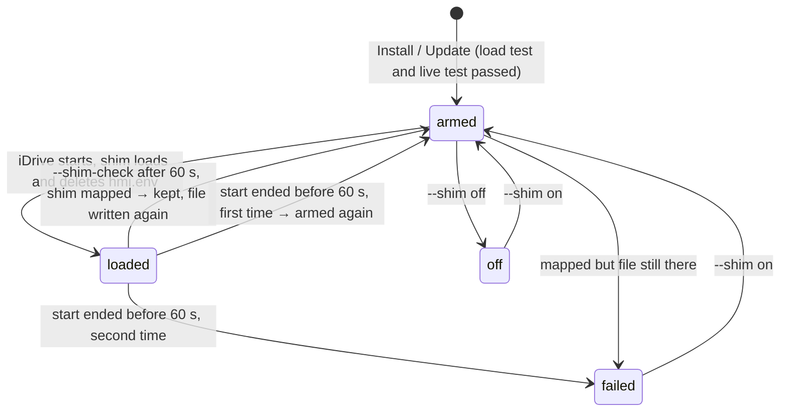

# iDrive's start and the capture shim

The input-capture shim ([input-capture.md](input-capture.md)) is loaded into
iDrive's program, HmiMain3D, when HmiMain3D starts. This page describes how the
head unit's process manager starts HmiMain3D, why it cannot be restarted alone,
and how the manager loads the shim through HmiMain3D's environment file and keeps
it from one start to the next. The facts come from the head unit's own files
(`starter.cfg`, the process manager `/opt/sys/bin/starter`, `OnOffDSICommander`);
those files are BMW's and are not part of this repository.



## Restarting

- **`OnOffDSICommander appreset` restarts the whole head unit**, although the tool
  names it `ApplicationReset`; its other modes are system, ECU, BIOS and boot-loader
  resets. None restarts iDrive alone. The installers and the manager call it
  **Restart the head unit** and ask first. SSH is off after it.
- **The process manager runs everything in `starter.cfg`** (`starter -A -s -e -g
  -vvv -p 30 -S libnbt_starter_plugin-omap.so ... -c /opt/sys/etc/starter.cfg`) and
  groups processes into packages, each requested to `RUN` or `STOP`.
- **Package 14, `HMI`, holds only process 17, HmiMain3D.** Its configured state is
  `STOP`, so it is requested to run during start-up. It requires package 13
  (`HMI_BMW_OTF_AGENT`, process 16); no package requires package 14. `inetd`,
  which starts `sshd`, does not depend on HmiMain3D.
- **HmiMain3D's process entry** has `OnTerminate IGNORE_ALL`, `MaxProcessRestarts
  0`, `FinalAction IGNORE` and `<Shutdown>IGNORE</Shutdown>`: the process manager
  neither restarts it nor acts when it ends, and stopping its package leaves it
  running.
- **Package requests** reach the process manager as a `devctl` on its resource
  manager `/dev/starter` (also used by the lifecycle manager `OnOffHuOmapApp`):
  `0x800c050f`, 12 bytes `{uint32 domain, uint32 package, uint32 command}`; the
  package key is `domain << 16 | package`; commands `RUN` = 2, `STOP` = 3 (above 3
  is refused). `0xc0080508` queries a package's state. The main file's packages are
  domain 0; `starter.cfg`'s domain table lists 1 Connectivity, 2 Media,
  3 NavigationEceUsa and 4 NavigationAsn.

A `STOP` of package 14 is accepted (`Package [14]: 'STOP' 'HMI'`) and a `RUN`
moves it through `POST_STARTING` to `RUN` without a reset, but HmiMain3D keeps
running. Ending HmiMain3D directly is not safe: the process manager refuses a
process that has used up its restarts (0 for HmiMain3D) and can shut the system
down for it. **iDrive therefore cannot be restarted alone**, and the shim takes
effect at the next real start of the head unit. The launcher's `--restart-hmi`
(`src/launcher/hmi_restart.cpp`: `STOP` of 0.14, wait up to 10 s, `RUN`, wait up
to 30 s for a new HmiMain3D, printing `HMI_RESTART ...` lines) and `--try-shim`
remain for diagnosis only; `tests/test_hmi_restart.cpp` covers the sequence
against a fake process manager.

## The environment file

**Each process's `<EnvFile>` is read at every start of that process.** When the
entry is not empty, the process manager checks the file with `stat`. Missing, it
logs "extern environment file: %s not available for process %s!" at level 3 and
starts the process normally. Present, it reads it: lines of up to 512 bytes, `#`
comments and lines without `=` skipped, `name=value` with no space between words,
leading spaces, single quotes and a trailing `;` removed. Each entry *replaces* a
variable of the same name after the `Environment` table is applied, so an
`LD_PRELOAD` line must repeat BMW's three preloads. The entries are freed after the
start, so the next start reads the file again. (The process manager also takes
`LD_PRELOAD_<program name>` from its own environment, set only when it starts, so
of no use here.) Every process in the stock `starter.cfg` has an empty
`<EnvFile/>`.

**Install and Update** set HmiMain3D's entry to
`<EnvFile>/var/opt/nbt-manager/state/manager/hmi.env</EnvFile>` with one edit of
`starter.cfg` (`src/storage/starter_config.cpp`). `starter.cfg` is read at boot,
so the entry takes effect after one restart of the head unit. The file, when
present, holds one line, written whole and renamed into place
(`src/storage/hmi_env.cpp`):

```
LD_PRELOAD=libEGL_X.gpp.so:libGLESv2_X_FORWARD.gpp.so:libKD_X.gpp.so:/var/opt/nbt-manager/state/manager/libnbt-capture.so
```

**The shim lives next to the file**, in `/var/opt/nbt-manager/state/manager/`
(the shim 0700; HmiMain3D runs as root). An update of `/opt` cannot remove one and
keep the other, and if `/var/opt` were not mounted at boot neither would be there
and iDrive would start as stock. `/fs/sda0` is remounted only for the
`starter.cfg` edit. Children of iDrive get both paths stripped from their
`LD_PRELOAD`.

## Keeping the shim

Each arming of the file covers one start of iDrive:

- **The shim deletes the file when it loads into iDrive** (a constructor in
  `src/capture/shim_env.c`, before iDrive's `main`, only in HmiMain3D). Whatever
  happens to that start, the next one is stock unless the manager arms the file
  again.
- **Install and Update arm a new shim** once it passed the load test and the live
  test: the file is written and `state/manager/shim-state` records `armed` with the
  shim's SHA-256. The same shim installed again keeps its state.
- **60 s after iDrive starts, the plugin runs `launcher --shim-check`**
  (`plugin/phone_runtime.cpp`, `src/launcher/shim_control.cpp`, without the
  manager's operation lock). It looks at the record, at whether this iDrive has
  `libnbt-capture.so` mapped (`DCMD_PROC_MAPINFO`, `DCMD_PROC_MAPDEBUG`) and at
  whether the file is still there:

  | Shim mapped | File | Result |
  | --- | --- | --- |
  | yes | gone | `kept`, strikes cleared, the file written again for the next start |
  | no | there | still waiting for a start that reads it (after an update, the next restart of the head unit) |
  | no | gone | a start with the shim ended before 60 s: armed again the first time; `failed` and no file the second time in a row |
  | yes | there | the shim did not delete it: `failed`, file removed |

  In state `failed` or `off`, nothing changes.
- **`--shim on`** arms it again with no strikes; **`--shim off`** removes the file
  and records `off`. A new shim (Update) is armed whatever the old one's state;
  Remove deletes the file and the record first.
