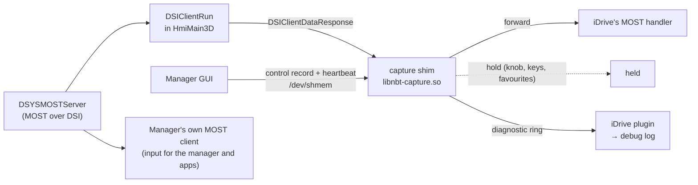

<!-- SPDX-License-Identifier: MPL-2.0 -->
# Input capture

While the manager or one of its applications is on the panel, iDrive
(`HmiMain3D`) must not act on the iDrive controller: every knob turn, push, tilt
and hard key must reach the manager only, without duplicates
([controller-input.md](controller-input.md)). A small preload library, the
**capture shim** `libnbt-capture.so`, sits in front of iDrive's DSI callback and
holds those MOST messages back while the manager says so.

The manager and its applications read the controller through the manager's own
MOST client, never through iDrive, so they are unaffected by what the shim holds.

## Why a preload shim

- **A second MOST client** (request 0x1) does not take input away: both the
  manager's client and iDrive receive every MOST input message.
- **Wrapping iDrive's start** does not help: HmiMain3D connects to
  `DSYSMOSTServer` over DSI itself rather than inheriting input from a parent.
- **Suspending HmiMain3D** (`SIGSTOP`, stopping its main loop) makes its peers miss
  their heartbeats; the watchdog resets iDrive within about 20 s.
- **`CRemoteControlService`** (`libhmiremoting.so`) injects `rotary` and `button`
  events into iDrive (`hmiplugin::getTCDevCCS35up()`); it does not intercept the
  physical controller.

## The hook

Firmware NBTevo_Y21432J:

| File | SHA-256 |
| --- | --- |
| `sys/lib/libsys_dsi_base.gpp.so.4` | `6a25bdb99fdfabccf5a8189c1fc21b5f74083229d8db179110357f64300871ed` |
| `sys/lib/libsys_dsi_colibry.gpp.so.8` | `f559c5c1455ed62e376ec72fdb77d5211b748bc9167f9c6866083db1515d19b4` |
| `hmi/ID5/bin/HmiMain3D` | `f397906974addd57c946dfd04243477506560893f3ea405e81b4369ce7a47df5` |

**`DSIClientDataResponse`** (`libsys_dsi_base.gpp.so.4`, `0x3d20`):
`void DSIClientDataResponse(void *client, void *stream)`.

- `DSIClientRun` (`0x47cc`), for command 8, replies to the QNX message first
  (`MsgReply`) and then calls `DSIClientDataResponse` through the PLT (no
  `-Bsymbolic`), so a preloaded definition takes the call.
- It has no consistent return value and `DSIClientRun` ignores it. The shim must
  therefore always reach the real function for anything it forwards: it resolves it
  with `dlsym(RTLD_NEXT)` and falls back to `dlopen("libsys_dsi_base.gpp.so.4",
  RTLD_NOLOAD | RTLD_LAZY)`, with a self-address check and a re-entrancy guard.
- After it returns, `DSIClientRun` loops to `DSIReceive` → `DSITimedReceive`, which
  calls `DSIClose(stream)` before the next message. Returning early holds a message
  cleanly: nothing is left unreplied and no buffer leaks.

**The stream** (`DSIOpen`, a zeroed 64-byte struct): `+0x00` capacity, `+0x04`
bytes populated, `+0x08` channel, `+0x0c` read position, `+0x10` buffer, `+0x14`
error flag, `+0x18..+0x34` QNX message metadata and chunk flags. The shim peeks
only when the error flag is clear, the buffer is set and
`0 <= read_pos <= populated <= capacity`, reads at most `populated - read_pos`
bytes, and changes neither the read position nor the buffer.

**The 16-byte DSI header** that `DSIClientDataResponse` reads first: `+0x04`
result/command code (`0`, `0x201`, `0x204`, `0x205`); `+0x08` information id
(`0x80000001` selects `InformationProcessMessage`); `+0x0c` request token. The
MOST message follows at `read_pos + 16` in the layout `src/most/codec.cpp` decodes
(destination, source, FBlock, instance, function, op, data).

**Process and client.** HmiMain3D is process 17 in `starter.cfg`
(`/opt/hmi/bin/zipped/HmiMain3D`, `-c=DSI,MOSTSubSystem ...`). Its MOST client is
named `MOSTSubSystem.DSYSMOSTServer` at `client+0x20` (formatted by
`DSIClientInit`), DSYSMOSTServer 4.5. A client struct is re-registered unchanged on
a server disconnect, but `DSIClientFree` clears it and the memory may be reused for
another service, so the shim checks the name on every call rather than caching a
pointer. The shim acts only inside HmiMain3D: QNX 6.5 has no
`/proc/self/exefile` and `__progname` follows `argv[0]`, so it asks
`devctl(DCMD_PROC_MAPDEBUG_BASE)` on `/proc/self/as` for the executable's path.
The manager's GUI uses the C++ colibry path (`CDSIClient::handleDataResponse`),
which never calls `DSIClientDataResponse`; children of iDrive get the shim
stripped from their `LD_PRELOAD` anyway.

**Segmentation.** DSI chunks are reassembled in `DSITimedReceive` before the
callback runs, and iDrive dispatches each MOST message to `CDevCCS35up` /
`CHmiCCSController` directly; controller functions arrive as single messages.
Anything unexpected is forwarded unchanged.

## QNX 6.5's loader

On QNX 6.5 (`ldqnx.so.2`):

| Case | Result |
| --- | --- |
| A preloaded library defining a symbol another library calls through its PLT | The preload takes the call; `dlsym(RTLD_NEXT)` finds the next definition |
| Several preloads | Constructors run right to left; the `RTLD_NEXT` chain runs left to right |
| An empty entry in `LD_PRELOAD` (`::`, a leading or trailing `:`) | The program stops before `main` (`Could not preload library`) |
| A missing, unreadable or malformed preload, or one with a missing `DT_NEEDED` | The program stops before `main` |
| An unresolved symbol, lazy binding | The program starts and aborts at the first call |
| An unresolved symbol with `LD_BIND_NOW=1`, or an unresolved data symbol | The program stops before `main` |
| `dlopen(..., RTLD_NOLOAD \| RTLD_LAZY)` of a loaded library | Returns the existing handle without a second load |
| A library opened `RTLD_LOCAL` calling its own function | Not interposed (HmiMain3D links `libsys_dsi_base` through `DT_NEEDED`, so it is) |
| A spawned child | Inherits `LD_PRELOAD` unless it is stripped; stripping one entry keeps the rest in order |
| Concurrent first calls | `pthread_once` serializes the resolution |

So a bad shim stops iDrive before `main`. That is why every shim is load-tested and
tested live before iDrive is told to load it, why the shim and the file that names
it live side by side, and why removal restores `starter.cfg` before deleting the
shim ([hmi-restart.md](hmi-restart.md), [install-flow.md](install-flow.md)).

## What is held

While the GUI's control record says *on* (the manager's or an application's
surface on the panel, a fresh heartbeat, a live GUI process), the active build
(`-DNBT_CAPTURE_OBSERVER=0`, the car build) holds, presses and releases alike:

- FBlock 0xE5, the iDrive controller: 0xC46 (knob, push, tilt), 0xC47 and 0xC4F
  (hard keys) on the CCS35up instance, 0xC10 and 0xC20 on the older controller's;
- FBlock 0x15 function 0xC02, the favourite keys, on any instance (a favourite
  key's release reaching iDrive would run the stored favourite).

`nbt_capture_classify_bytes` and `is_input_message` decide. Volume is never held:
AudioMaster 0x20 (0xC08), the centre stack's volume button 0xC01 and the rear
volume functions are not candidates. The observer build forwards everything and
only records what it would hold.

**The centre stack's functions** (FBlock 0x15, the `CPxyCECenterStack` proxy,
factory instance 0x0C): 0xC01 `CAudioVolumeButtonCS`, 0xC02
`CFunctionalBookmarkButtons` (eight one-byte key states, op 0x0C), 0xC03
`CPushButtonAmFmTP`, 0xC04 `CPushButtonAudio`, 0xC05 `CPushButtonEject`, 0xC06
`CPushButtonMode`, 0xC07 `CPushButtonSkip`.

## Control record, watchdog and escape

- The GUI writes a control record and a heartbeat in `/dev/shmem`, with the same
  owner, mode and inode checks as its other shared files; the shim caches it for
  at most 100 ms and checks liveness on every message.
- **Watchdog:** a record older than 1.5 s, or one naming a GUI process that no
  longer exists (`kill(pid, 0)`), releases capture. The shim refuses any record
  that asks for more than 1.5 s (`NBT_CAPTURE_MAX_WATCHDOG_MS`), during
  installations too.
- **Escape:** BACK held for 5 s releases capture for the rest of that capture
  generation (the GUI also stops the application and exits; during an
  installation the GUI keeps installing, but the shim's escape still applies).
  A BACK hold is dropped whenever a message arrives with capture off and when the
  generation changes, so a BACK pressed during one capture and released outside it
  cannot trigger the escape at the next.

## Effects in iDrive

- **Rotary counter.** iDrive keeps the last knob position and turns by
  `abs(current - previous)` (`CHmiCCSController::onCCSRotaryEncoder`). Detents
  turned while captured are never seen, so iDrive's first turn after the manager
  closes moves by that many.
- **Retained keys.** iDrive keeps a pressed-state per key and drops unexpected
  transitions. A key pressed before capture and released during it stays pressed
  in iDrive until pressed again.
- **Controller health.** iDrive's consistency checks (`checkCcsNotifications`,
  `onConsistencyTimerElapsed`) look at MOST notification registration and re-send
  the rotary configuration when it is missing; they do not fault on input
  inactivity.

## Packaging and install-time tests

The shim ships in `NBTRLS2` releases as component 9 (`capture_lib`), C99, libc
only, exporting exactly `DSIClientDataResponse` and `nbt_capture_selftest_begin`
(`qnx-check` checks it). `make qnx-capture` builds it.

1. **Load test** (`src/storage/capture_probe.cpp`). The installed launcher's
   `--capabilities` runs in HmiMain3D's environment as `starter.cfg` gives it
   (`MALLOC_ARENA_SIZE`, `GRAPHICS_ROOT`, `LD_LIBRARY_PATH`;
   `src/storage/starter_env.cpp`): alone, then with a copy of the shim after
   iDrive's own preload list, in iDrive's order, with `LD_BIND_NOW=1`. If BMW's
   list cannot bind every symbol outside HmiMain3D, the list loads lazily and the
   shim alone with everything bound; if the list does not load at all, the shim
   alone. Every run must exit 0 within 5 s, or the install stops before anything on
   `/fs/sda0` changes: "capture shim refused, nothing changed: <reason>". This
   catches whatever stops a program before `main`.
2. **Live test** (`src/launcher/capture_selftest.cpp`). The launcher loads the shim
   with `dlopen` and calls `nbt_capture_selftest_begin`, which points the shim's
   control, heartbeat and diagnostic files at private files in `/dev/shmem`, its
   clock at the test's and its forward target at a counter (refused inside
   HmiMain3D). With the GUI's own writers and MOST messages built as the MOST
   client sends them, it checks: capture off (forwarded); on with a fresh heartbeat
   (knob, BACK and a favourite key held by the active build, recorded by the
   observer build); another client (forwarded, not recorded); a heartbeat 1.5 s
   old (forwarded); switched off (forwarded); BACK held 5 s (the escape, then
   forwarded for that generation); BACK pressed captured and released uncaptured,
   then a new capture (still held); a GUI that no longer exists (forwarded). Any
   difference refuses the shim with the failed step; a pass logs "live test OK
   observer" or "active".

A refused shim does not stop the rest of an update: the launcher and plugin are
still replaced, and the launcher names the reason to the installer
(`NBT_REFRESH_CAPTURE_REFUSED`). If the shim cannot find the real
`DSIClientDataResponse` it forwards nothing and records it, and the plugin logs
`capture shim: real DSIClientDataResponse not found`.

## Diagnostics

The shim keeps a lock-free ring of its last decisions in shared memory, drained by
the iDrive plugin into the debug log. Each record carries its kind (forwarded,
held, escape, BACK hold dropped and so on), the FBlock (`fblock=0x15` for a
favourite key), the capture generation and a detail byte; an escape records how
long BACK was held. Whenever the debug log moves to a new file (switched on, off
and on, rotated), the plugin logs `capture shim active` and replays the ring as
`capture diag (earlier)`, so every fetched log starts with the shim's state and its
last 32 decisions.

The GUI reads the ring once a second while capture is wanted (`CaptureWatch`) and
shows a line on the manager's list when the keys reach iDrive too: `iDrive gets
the keys too (BACK held 5 s)`, `(shim not blocking)` or `(shim not loaded)`, logged
as `capture: controller keys ...` when it changes. **Settings → Status**
(`src/gui/status_page.cpp`) shows the same, `Keys: kept from iDrive` included.
