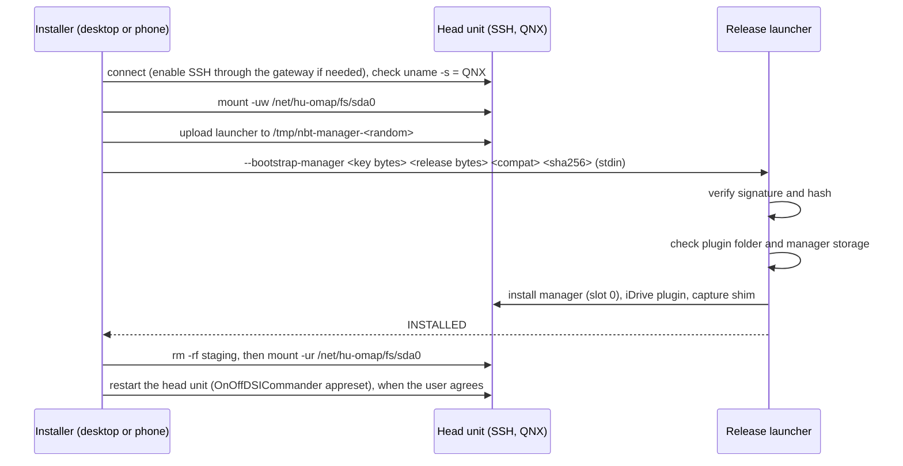
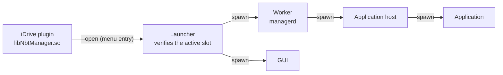

# Install flow

How NBT Manager gets onto the head unit and what each side checks. The installer
itself (desktop and phone) is `NBTFoundry/installer`; the release format, slots
and updates are in [manager-release.md](manager-release.md); the tester's steps
are in [in-car-procedure.md](in-car-procedure.md).

## Installer

The installer connects over SSH to `169.254.199.119` (the head unit's published
user and root password). Every remote command runs as if typed in an SSH
session, in a login shell (`/bin/sh -l -c '…'`), which reads the profile and so
has the session's `PATH` and `LD_LIBRARY_PATH`; the shell sshd starts for a bare
command reads no profile.

1. **Connect.** If SSH does not answer, offer to enable it (gateway discovery and
   the activation relay). Then `uname -s` must say QNX.
2. **Install**, the same five steps every time:
   1. `mount -uw /net/hu-omap/fs/sda0 && echo OK` (the plugin partition is
      read-only at boot).
   2. Upload the launcher: `umask 077; mkdir /tmp/nbt-manager-<32 hex> && cat >
      …/launcher && chmod 700 …/launcher && echo READY`.
   3. `…/launcher --bootstrap-manager <key bytes> <release bytes> <compat>
      <sha256>`, with the manager public key and the signed release on stdin;
      expects `INSTALLED`.
   4. `rm -rf <staging>; test ! -e <staging>`, also after a failure.
   5. `mount -ur /net/hu-omap/fs/sda0 && echo OK`, also after a failure. A
      refusal is reported as a note; the install result stays.
3. **Restart.** After an install the user restarts the head unit (**Restart the
   head unit**: `OnOffDSICommander appreset`, which restarts the whole system, not
   iDrive alone) or switches the car off and on. The restart takes SSH down and
   switches it off; after at most 20 s without an answer the installer counts it
   as under way and disconnects. Once the head unit is back, Connect offers to
   enable SSH again. The installer never reboots the unit on its own.

**Update** runs the release's own launcher, uploaded as for Install: remount,
upload, `…/launcher --stage-update <bytes> <sha256>` with the release on stdin
(expects `PENDING`), `…/launcher --refresh-setup` (replaces the installed launcher
and the iDrive plugin; `REFRESHED plugin` asks for a restart), remove the staging
folder, remount read-only. The installed launcher is never run, so any installed
version can take the update. On a head unit without NBT Manager, Update says to
use Install.

**Rules for remote commands** (QNX 6.5's utilities): no `printf` (the head unit
has none) and no `rmdir`; never chain on `rm`'s exit status (undocumented for
missing files); every command ends with an `echo` acknowledgement the installer
checks. `known_error` in the installer's `ssh.rs` turns `HMI layout: …` and
`manager storage: …` into readable messages.

The phone app runs the same installer core over a Wi-Fi ENET adapter
(`NBTFoundry/installer: mobile/`, the app's `car-install` module). A phone cannot
reach `169.254` addresses over Wi-Fi, so it relies on the head unit taking an
address from the adapter's DHCP server; the installer core searches the gateway's
network for it.

## Launcher

`apps/manager/launcher.cpp`, `src/launcher/`. Modes: `--open` (the iDrive menu
entry), `--door`, `--capabilities`, `--bootstrap-manager`, `--stage-update`,
`--stage-recovery`, `--refresh-setup`, `--remove-capture`, `--provision-app`.

`--bootstrap-manager` (`src/launcher/bootstrap.cpp`), in order:

1. QNX 6.5 on ARMv7, else `unsupported platform`.
2. Read the key and the release into unlinked temporary files (exact lengths,
   EOF, deadlines); verify the signature against that key and the SHA-256
   against the command line.
3. **Plugin folder** `/opt/hmi/ID5/data/ro` (`src/storage/hmi_plugin_dir.cpp`):
   the fixed path as given (no `realpath`); a directory owned by the installing
   user, writable by nobody else except root's group, on writable qnx6, not
   noexec; device and inode pinned. Refusals: `HMI layout: <check>`.
4. **Plugin preflight:** refuse a different NbtManager plugin already installed.
5. **Manager root** `/var/opt/nbt-manager` (`src/storage/setup.cpp`): parent
   present, same owner, group write only for root's group, writable, not noexec,
   qnx6, enough space; the root is created 0700. Refusals: `manager storage: <check>`.
6. **Manager setup** (`src/launcher/manager_setup.cpp`): key, profile, launcher,
   upload, then slot 0, each verified by hash. Re-running with the same release is
   accepted; a different existing install is refused.
7. **Plugin install** (`src/launcher/plugin_installer.cpp`): the five files into
   `Plugins/.NbtManager.setup` (`.so` 0755, others 0644, verified), the folder
   chmod 0755, sync, then renamed to `Plugins/NbtManager`.
8. **Input-capture shim** (`src/storage/capture_install.cpp`, `NBTRLS2` releases):
   1. Verify `/opt/sys/etc/starter.cfg`: Environment 6 `System_HMI_PRELOAD` stock
      (or with the shim of an older install), HmiMain3D's `<EnvFile/>`.
   2. Save a verified backup to `state/manager/starter.cfg.orig` with
      `state/manager/capture.tx`.
   3. Load a copy of the shim into the launcher's `--capabilities` with
      `LD_PRELOAD` and `LD_BIND_NOW=1`; refuse unless it exits 0
      (`src/storage/capture_probe.cpp`). Nothing on `/fs/sda0` has changed yet.
   4. Drive it live through the launcher's `--capture-selftest` (capture on and
      off, heartbeat, the 5 s escape, a GUI that is gone) and refuse unless every
      step behaves as built.
   5. Write and verify the shim next to iDrive's environment file,
      `state/manager/libnbt-capture.so` (0700, on `/var/opt`, no remount).
   6. With `/fs/sda0` writable only for this, set HmiMain3D's `<EnvFile/>` to
      `<EnvFile>/var/opt/nbt-manager/state/manager/hmi.env</EnvFile>` atomically
      (an older install's Environment 6 entry goes back to stock in the same
      write; every other byte, CRLF line endings, permissions and ownership kept).
   A different shim deletes the environment file and the shim's state before it
   is written. A verified new shim is armed (the file written, state `armed`) for
   iDrive's next start, and the manager keeps it armed from then on
   ([hmi-restart.md](hmi-restart.md): the shim deletes the file when it loads,
   the plugin's 60 s check writes it again). On a downgrade to `NBTRLS1` or
   `nbt-manager-launcher --remove-capture`, the environment file is deleted first,
   then `starter.cfg` is restored and verified **before** the shim is deleted. If
   `starter.cfg` has unrelated edits, removal refuses to restore it and keeps the
   shim and the backup.
9. Print `INSTALLED`.

### Capture shim, firmware updates and recovery

- **Before a BMW firmware update, remove NBT Manager** (installer **Remove**, or
  `nbt-manager-launcher --remove-capture` over SSH) and install it again
  afterwards. The shim and the environment file that names it sit side by side on
  `/var/opt`, so an update of `/opt` cannot remove one and keep the other; without
  the file, iDrive starts as stock whatever `starter.cfg` names.
- **Remove with an older launcher:** the installer asks for `--remove-capture`
  only when a shim exists. Deleting `/var/opt/nbt-manager` deletes the environment
  file too, so iDrive starts as stock even if `starter.cfg` still names it.
- **A missing `starter.cfg` backup** is rebuilt from the current file when it
  holds exactly the stock value plus the manager's entry; anything else is refused.
- **A firmware update that rewrote `starter.cfg` or `/opt/hmi/ID5/data/ro`:**
  `SETUP` and `--refresh-setup` compare `starter.cfg`'s capture entries and
  `state/manager/libnbt-capture.so` with the confirmed release. If `starter.cfg`
  is stock again with a layout that differs from `state/manager/starter.cfg.orig`,
  remove the old backup (`--remove-capture` when unmodified, or compare the two
  files by hand) before setting up again, so the backup never lags behind the
  firmware.
- **iDrive does not start with the shim** (only if the loader refused it before it
  ran; the install's load test refuses that case, and the shim deletes the
  environment file as it loads, so the next start is stock anyway). Over SSH:
  0. Quickest: `rm /var/opt/nbt-manager/state/manager/hmi.env` (or
     `nbt-manager-launcher --shim off`); iDrive's next start is stock.
  1. `mount -uw /net/hu-omap/fs/sda0`
  2. `/var/opt/nbt-manager/manager/nbt-manager-launcher --remove-capture`, or by
     hand: verify `state/manager/starter.cfg.orig`, copy it over
     `/opt/sys/etc/starter.cfg` through a temporary file and `mv`, check
     HmiMain3D's `<EnvFile/>`, then delete `state/manager/libnbt-capture.so`.
  3. `mount -ur /net/hu-omap/fs/sda0`, then `OnOffDSICommander appreset`.

## At run time

The plugin starts `--open`. The launcher verifies the active slot and starts the
worker, then the GUI, with QNX `spawn()` and a descriptor map in the HMI's
environment, and gives each one end of their private channel. QNX 6.5's `fork()`
fails (`ENOSYS`) in a process with threads, so every process the manager starts
is spawned. If either process ends abnormally, the launcher stops the other and
restarts both; a new selection gets fresh restart attempts unless an update is on
trial. With the debug log on, the launcher logs each step (slot verified, worker
and GUI started with their pids, GUI ready, exits and why) and every failure; the
worker and GUI write their early errors to the same log.

An install session opens one packet-filter rule through `/dev/pf` for its port
(`src/worker/firewall.cpp`), removed when the session ends and at worker start.
`/etc/pf.conf` is never touched.

## Head unit facts

Firmware NBTevo_Y21432J:

- `/opt` links to `/fs/sda0/opt` (qnx6, read-only at boot); `/opt/hmi/data` and
  others link into `/opt/hmi/ID5`. `/var/opt` is on `/fs/sda1` (qnx6, writable).
- `/opt/hmi/ID5/data/ro` and `/var/opt` are `root:root 0775`; `Plugins` is
  `root:root 0755`; plugin files are `root:root 0644`.
- `OnOffDSICommander appreset` restarts the head unit and switches SSH off: enable
  it again afterwards, as after a reboot.
- QNX 6.5 `mount`: `-u` remounts, `-w`/`-r` select the mode; a remount without
  `-r` returns to read/write.

## Kits

`make kit` (`tools/make_kit.py`) builds a test kit from a clean commit: it runs
`qnx-check stack-report` in the QNX 6.5 environment (`QNX_ENV`, `QNX_SCREEN_LIBDIR`,
`RHMI_LIBDIR`), builds the Windows kit with the capture shim
(`tools/build_windows_kit.py`, with the sibling `../installer` and `../mobile-app`
checkouts), and, when `NBT_KIT_DIR` is set, copies the zip and the unzipped folder
there without replacing either and checks every file against `SHA256SUMS.txt`
(`KIT_ARGS=--no-copy` builds and checks only). Each kit takes the next sequence
from the keys directory. Shipped QNX binaries are stripped; the unstripped links
stay in `build/qnx-unstripped/` to resolve crash addresses.

## Testing and debugging

- Host tests: `make test`; launcher refusals are covered in
  `tests/test_manager_stage.py`. The installer's end-to-end test
  `native_install_then_update_over_ssh` runs this repository's
  `build/launcher-host` behind a mock SSH server (`NBTFoundry/installer` README).
- On the car: tick **Debug log** in the installer; its log names every remote
  command with its exit status and stderr. The head unit's own debug log
  (`manager/debug.log`) is switched on and fetched from Test tools; **Collect
  everything** saves it with the system log, the audio connections and the process
  and file listings in one `collect-<time>.txt`.
