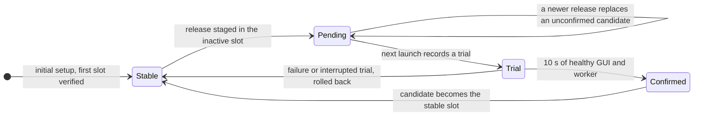

# Manager release format

Manager releases use a key reserved for the manager, separate from managed
application keys. The signing workstation retains the private key; the trusted
public key is provisioned independently. This format and verifier do not install
or activate a release.

`NBTRLS1` contains a 16-byte header, an exact-byte ASCII manifest, a 384-byte
RSA-3072/SHA-256 PKCS#1 v1.5 signature over the header and manifest, then eight
raw component payloads in fixed order. The header is `NBTRLS1\n`, followed by
big-endian 32-bit manifest length and signature length. The manifest fields are
ordered `version`, `sequence`, `platform`, `compat`, optional `bridge` lines
(see below), followed by a `_size` and
`_sha256` field for each of: `launcher`, `gui`, `worker`, `plugin_lib`,
`plugin_manifest`, `plugin_xml`, `plugin_text`, `plugin_images`. Each field is
`name=value\n`; duplicate, extra, malformed and out-of-order fields are rejected.

`NBTRLS2` keeps that exact header, signature, bounds and eight components and
appends a ninth component, `capture_lib` (an ARMv7 ELF shared object `ET_DYN`
for the early-boot DSI preload shim). Both formats share the same manager signing
key and strict verification rules. `nbt-manager-launcher --capabilities` prints
`formats=NBTRLS1,NBTRLS2`. The installers do not ask it: their Update stages
a release with that release's own launcher (docs/install-flow.md), so an
`NBTRLS2` release needs no `NBTRLS1` step first and kits carry one release.
From the phone's manager page (the worker), a manager older than `NBTRLS2`
cannot take an `NBTRLS2` release: update it over SSH (Windows or the phone's
installer).

Each optional `bridge=<major>.<minor>|<capabilities>` line declares one served
major, in increasing major order, at most two. Canonical version components
are bounded to 16 bits (major is nonzero); comma-separated capability names
are unique, 1-24 lowercase letter/digit/hyphen characters starting with a
letter, at most 255 bytes per list. An empty list uses a trailing `|`.
`tools/package_release.py` defaults to `tools/bridge.py`'s `CURRENT`,
`bridge=1.4|show,status,live-settings,most,gamepad,controller`.
Repeated `--bridge '1.0|...'` overrides describe the actual built worker;
`--no-bridge`, or a legacy release without lines, serves no bridge. The C and
Rust verifiers validate these signed fields independently.

Staging checks every installed application's recorded requirements before
changing the inactive slot, under the manager operation lock and all app
transaction locks. A normal update that drops a required version/capability
fails with the application name. Explicit older-release recovery allows a
mismatch and writes `Recovery warning: <app>: <reason>` to stderr. Busy or
invalid application records still stop staging. Pending/trial activation blocks
new application provisioning/updates so its dependency snapshot stays valid.
Provisioning reads the active authenticated release's provider, keeping this
check independent of the stable launcher's own age.

Initial setup installs the launcher that understands this contract.
Ordinary manager updates replace only GUI and worker. See
[the bridge contract](app-bridge.md) for application records.

Each nonempty component is at most 64 MiB and the combined payload is at most
128 MiB. The first four components must be QNX-compatible 32-bit little-endian
ARM ELF; the plugin library must be a shared object. This ELF check establishes
architecture and object type only, not runtime ABI compatibility. The verifier
checks all lengths, the signature, every payload digest and exact end of file.
Component identifiers are fixed roles, not paths or installation instructions.
The component-copy API rechecks the digest while copying into a caller-supplied
new empty file. The caller must obtain that file through the path policy and
remove a partial output after any failure; the copy API does not activate files.

Build the QNX binaries and plugin bundle, then package with an external private
key:

```sh
python3 tools/package_release.py --version v1 --sequence 1 --compat demo-1 \
  --key manager-private.pem --launcher build/nbt-manager-launcher \
  --gui build/nbt-manager-gui --worker build/nbt-managerd-qnx \
  --plugin-dir build/NbtManager --output manager-v1.nbtr
build/nbt-verify-release manager-v1.nbtr manager-public.pem demo-1
```

The desktop installer and target launcher enforce the manager signing key,
release sequence, installation and rollback policies described below. A valid
signature alone does not establish hardware compatibility.



A normal update stages a higher sequence; recovery stages an older release
without lowering the high-water mark. Once confirmed, the candidate's slot is
the stable one and the high-water mark rises to its sequence.

The manager state module provides bounded, path-free activation records and
in-memory transitions for a stable slot and a pending candidate. Normal updates
increase the high-water mark only after a supervised process proves healthy;
explicit recovery may select an older release without lowering that mark.
Rollback restores the previous slot and digest. Callers must verify each slot's
release against the independently provisioned manager key and match its digest
and sequence to the record. The store writes records under `state/manager`
through the path policy, serializes changes and discards an interrupted temporary
record only when a valid committed record exists. If the first record is
interrupted before commit, setup retries it only after re-verifying the complete
initial slot against the signed release.

The staging core expects a separately provisioned `trust/manager.pem` public key,
`trust/manager.conf` containing `NBTMANAGERPROFILE1\ncompat=<token>\n`, private
`manager/slots/0` and `manager/slots/1` directories, and a release uploaded to
`state/manager/release.upload`. These paths are fixed by the path policy. It
verifies the uploaded release, verifies the current signed slot and its GUI and
worker before touching the inactive slot, and re-verifies the staged bytes
before recording a pending update. It refuses to stage while the GUI lock is
held. The launcher verifies the signed slots, records a trial before launch and
confirms it after 10 seconds of healthy GUI and worker operation. An interrupted
trial is rolled back on the next launch, and staging a newer release drops a
candidate that never confirmed (staged but never opened, or a trial cut short)
for the known-good slot first, as that launch would. The launcher and staging core serialize
through the manager operation lock. Initial setup retries interrupted first
installation after verifying its signed release and existing slot contents.

The signed release also contains the launcher and plugin. Updates stage only
the GUI and worker, so release publishers must keep them compatible with the
installed launcher for the trial. Once a release is confirmed, the running
manager replaces the stable launcher and the iDrive plugin with the release's
own and asks the driver to restart iDrive when the plugin changed (`SETUP`,
PROTOCOL.md "The manager's own installation"). A paired phone can send a
release; the launcher stages it at the next opening (PROTOCOL.md "Manager
updates from a phone").

The provisioned launcher accepts `--stage-update SIZE SHA256` with the signed
release on standard input. It requires exact length and EOF, applies idle and
overall deadlines, verifies the manager signature and declared digest before
replacing its private upload, and binds staging to that same digest. Success
prints `PENDING`; the candidate is confirmed only after a subsequent successful
supervised launch. `--stage-recovery` uses the explicit older-release policy.

Initial enrollment has a host-tested target transaction that verifies the
release and manager key before provisioning the private manager layout. It
publishes the key, profile and launcher through fixed temporary files and
stages the first signed slot. Retrying accepts matching completed files and
refuses conflicts; interrupted slot writes restart from the verified release.
The desktop installer invokes this transaction and HMI registration over SSH.

The launcher also provides a first-install stream receiver. It
requires exact declared lengths and EOF, checks the release signature and
expected digest, checks the target and storage, and only then creates the
managed root. It preflights the HMI layout and registers the plugin after
manager enrollment. The desktop application supplies the signed launcher and
release over SSH.

The initial HMI registration transaction publishes the five signed plugin
components to a dedicated `Plugins/NbtManager` directory. It checks the HMI
root and filesystem, preserves existing plugins, rejects extra or unsafe
entries and can retry its private staging directory after interruption. It
requires the HMI filesystem to be writable.

The target checks QNX 6.5 and its ARMv7 CPU flag before enrollment. QNX
[documents the ARMv7 flag](https://www.qnx.com/developers/docs/6.5.0SP1/neutrino/technotes/QNX_for_ARMv7_Cortex_Processors.html)
and [requires a write-capable descriptor for `fsync`](https://www.qnx.com/developers/docs/6.5.0SP1.update/com.qnx.doc.neutrino_lib_ref/f/fsync.html).
