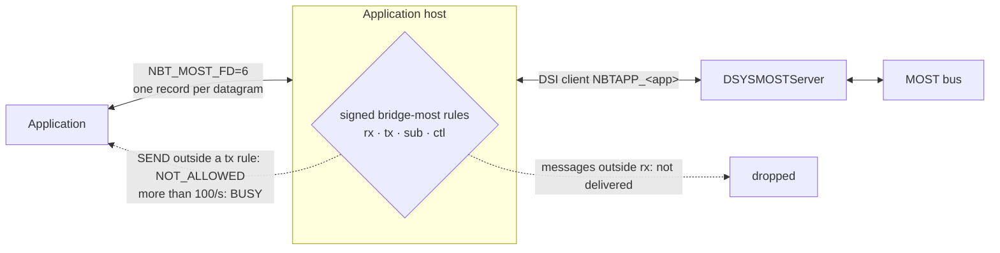

<!-- SPDX-License-Identifier: MPL-2.0 -->
# MOST bridge (capability `most`)

Applications reach the car's MOST bus through their host instead of opening
their own DSI client. The application declares in its signed package which
MOST functions it may receive, send to and control. Its host runs one MOST
client for it, enforces that declaration and relays messages over a datagram
socket. This document is the contract. It is part of bridge **1.2**.

Host tests run it against a stand-in DSI library (`tests/fake_dsi.c`). The
DSI ABI and the MOST server's behaviour are reconstructed (see
[controller-input.md](controller-input.md) and
[head-unit-interfaces.md](head-unit-interfaces.md)); the facts used here
that came from NBT-AAD are noted where they are used. No NBT-AAD code is
used.



## Declaring it

```text
bridge=1.2
bridge-uses=most
bridge-optional=
bridge-most=rx:05.00.621,rx:E5.*.*,tx:82.00.*,ctl:E5.03
```

With `tools/package.py`: `--bridge 1.5 --bridge-uses most --bridge-most '<policy>'`.
`most` may be optional instead (`--bridge-optional most`); the application then
starts without it when the host cannot open a MOST client.

`bridge-most` follows `bridge-optional`. It is present exactly when `most` is
declared, required or optional. It is one line of comma-separated rules:

| Rule | Meaning |
| --- | --- |
| `rx:<FB>.<II>.<FFF>` | deliver messages of this function, any op, both directions |
| `tx:<FB>.<II>.<FFF>` | allow commands (op 0-8) to this function |
| `sub:<FB>.<II>.<FFF>` | request Status notifications for a concrete function, covered by `rx` |
| `ctl:<FB>.<II>` | register this host's client as a device controller for this FBlock instance |

- `<FB>` and `<II>` are two upper-case hex digits (FBlock, instance) and
  `<FFF>` is three (the 12-bit function id). `*` stands for any instance or
  function.
- In `rx` rules only, `*.*.*` stands for every message (a bus monitor). A
  wildcard FBlock with a fixed instance or function is not allowed.
- `ctl` keys are concrete. They do not imply `rx`: declare `rx` for the
  messages the registration brings.
- `tx` does not imply `rx`, so declare `rx` for the replies too.
- `sub` values are concrete, exclude functions 0x000-0x002, and must match an
  `rx` rule anywhere in the policy. They do not grant `tx` or `ctl`.
- NetBlock (FB 01) `sub` rules are refused: its different notification
  interface has not been traced on this firmware.
- The limits are 640 bytes, 48 rules, 16 `ctl` rules and 32 `sub` rules. Rules are unique.
  Lower-case hex, spaces and empty rules are rejected.

The worker validates the policy when it verifies the package. A package with
a policy installs only on a manager that serves `most`. This holds even when
`most` is optional: only such a manager can store and enforce the policy.
For the same reason a manager release without `most` disables such an
application until it is updated (PROTOCOL.md, "Disabled until updated").

The installed record keeps the policy with the executable: `NBTSTATE3`
records and `NBTJ3` journals add `bridge-most=` after `bridge-optional=` (see
[PROTOCOL.md](../PROTOCOL.md)).

### NBT-AAD's policy

What NBT-AAD's MOST client uses, written as a policy:

```text
rx:E5.*.*,rx:15.*.*,rx:05.00.621,rx:05.00.626,rx:05.00.228,rx:05.00.CB5,
rx:52.00.440,rx:CD.01.C00,rx:CD.01.203,rx:20.*.C08,rx:82.00.*,tx:82.00.*,
ctl:E5.10,ctl:E5.03,ctl:E5.05,ctl:E5.12,ctl:E5.14,ctl:E5.01,ctl:E5.02,ctl:15.02
```

(one line, without the breaks). In order:
- the iDrive controller (E5) and the steering wheel buttons (15);
- speed, driving condition, gear and parking brake (05/00);
- the navigation position (52/00);
- the GNSS receiver status and heading (CD/01);
- the volume (20);
- the HUD/cluster navigation terminal (82/00): NBT-AAD sends it commands
  with op 6 (StartResultAck) and reads its replies.

The `ctl` keys are NBT-AAD's device controller list.

## At run time

A user launch granted `most` gets `NBT_MOST_FD=6`: descriptor 6 is one end
of an `AF_UNIX`/`SOCK_DGRAM` socket pair. Health-check launches get the
capability name but no descriptor, like `status`.

- **When it is available:** `most` is available only when the host has
  started its MOST client before launching the application. That needs the
  DSI library to load and its symbols to resolve. When the client cannot
  start, a required `most` stops the launch, and an optional one is left
  out of `NBT_BRIDGE_CAPS`.
- **One datagram is one record.**
- **Buffers:** both ends ask for 64 KiB.
- **Reading:** the host never blocks on the application. A record that does
  not fit is dropped and counted (`dropped` in STATE and MESSAGE).
- **Receive buffer:** the application should read promptly and use a buffer
  of `NBT_MOST_WIRE_RECORD_MAX` (4120) bytes.
- **Closing:** closing descriptor 6 ends the relay; the application keeps
  running.

The host registers its client as `NBTAPP_<app>` and subscribes to what the
HMI's own client subscribes to. It asks for the communication state once
the registration is answered and then registers the `ctl` keys. For registration it sends the
server requests 0xF (register client), 0x1 (device controls) and 0x2
(process message) only. It never sends `setCommunicationCtrl` or device
registrations.

### Host-managed subscriptions

`rx:05.00.621,sub:05.00.621` asks the host to subscribe to CarSpeed2, without
granting application sends. It requires bridge 1.2. The host waits until the
link is up and the registry lists a ring node for the instance. It sends
Notification.Set (control 1), using its per-client address, with at most four
big-endian u16 function IDs per message. Larger lists are split to match
iDrive's generated writer. These commands share the 100/s send budget with
application commands. No application may send functions 0x000-0x002, even
through a wildcard `tx`; concrete `tx` declarations naming them are invalid.

The host repeats subscriptions after comm-lost to up, detach/registration,
registry disappearance/reappearance and destination changes. Missing Status
responses trigger retries after 1, 2, 4, 8, 16, 32 and then 64 seconds until
each requested function has produced Status from the selected node. Unchanged
registry events retain confirmations. A clean host exit sends best-effort
ClearFunction (control 3) for this client's sent batches, allowing at most
400 ms of rate-limit waiting. Failed clears are logged. Abrupt process death
and remote notification expiry need bench validation.

The per-client address decision and byte layout have static evidence in
[head-unit-interfaces.md](head-unit-interfaces.md#notification-static-findings-nbtevo_y21432j).
No extra Get is sent after a Set; if a capture (bench step A1) shows that the
initial Status does not arrive, add that fallback with the capture as evidence.

### Upgrading policies

Bridge 1.1 applications keep working with bridge 1.2 when their policies remain
valid. Repackage applications with concrete `tx` rules naming 000/001/002
before upgrading the manager: those policies now fail validation. Wildcard
`tx` declarations remain valid, but sends to reserved functions return
NOT_ALLOWED. The installed-record and journal formats remain unchanged.

## Records

Little-endian. Every record starts with `{u8 version = 1, u8 type, u8, u8}`.
`include/nbt/sdk/most_wire.hpp` and `src/sdk/most_wire.cpp` provide the C++11
codec; `include/nbt/most_wire.h` and `src/sdk/most_wire_api.cpp` retain the C ABI
for existing applications. QNX applications using the C++ SDK compile with
`qcc -Vgcc_ntoarmv7le_gpp -lang-c++` and link the device's `libstdc++.so.6`.

**Host to application:**

| Type | Bytes | Layout |
| --- | --- | --- |
| 0x01 STATE | 12 | `[4]` link, `[5]` 0, `[6]` u16 own MOST address (while up or comm-lost, else 0), `[8]` u32 dropped |
| 0x02 REGISTRY | 8 + 4n | `[4]` u32 n (at most 1000), then n × {u16 address, u16 key = FBlock << 8 \| instance} |
| 0x03 MESSAGE | 24 + length | see below; `[2]` flags, `[16]` u32 dropped |
| 0x04 RESULT | 12 | `[4]` u32 request, `[8]` u8 code, rest 0 |

**Application to host:**

| Type | Bytes | Layout |
| --- | --- | --- |
| 0x81 SEND | 24 + length | see below; `[2]` 0, `[4]` src must be 0, `[16]` u32 request |

MESSAGE and SEND share a 24-byte header:

| Offset | Field |
| --- | --- |
| 0 | version 1 |
| 1 | type |
| 2 | flags (MESSAGE), 0 (SEND) |
| 3 | op, 0-15 |
| 4 | u16 source address (0 in SEND) |
| 6 | u16 destination address (0 in SEND: chosen by the host) |
| 8 | u8 FBlock |
| 9 | u8 instance |
| 10 | u16 function, at most 0xFFF |
| 12 | u32 tag (the server's MessageType header word; passed through, meaning unknown) |
| 16 | u32 dropped (MESSAGE) or request (SEND) |
| 20 | u16 data length, at most 4096; the record is exactly 24 + length |
| 22 | u16 0 |
| 24 | data |

Link states (STATE):

| Value | State | Meaning |
| --- | --- | --- |
| 0 | detached | no connection to the MOST server |
| 1 | registering | connected; registration not answered |
| 2 | refused | the server refused the registration |
| 3 | comm-lost | registered; communication was OK and is not now |
| 4 | up | registered; sending is possible |

The first record is always STATE detached. The car reports communication state 1
while messages flow (NBT-AAD's finding), so only a change away from OK
(2) after OK was seen counts as comm-lost. A detach clears the registry and
starts over.

REGISTRY is sent when its content changes; it lists which ring node hosts
which FBlock.

MESSAGE flags: 0x01 joined from segments by the host; 0x02 delivered
without transmission information (the server does deliver those).

## Receiving

Only messages matching an `rx` rule are delivered. Of segmented messages,
only whole ones are delivered: the host joins them like the vendor client,
by equal header, up to 4096 bytes and 8 pending messages, and drops what
does not fit. Transmit status reports are not delivered. Copies are
possible: the server delivers a message once per receiver.

## Sending

SEND asks the host to send one command:

1. `op` must be 0-8 (Set, Get, SetGet, Increment, Decrement, GetInterface,
   StartResultAck, AbortAck, StartAck). Otherwise BAD_REQUEST.
2. Functions 0x000-0x002 are reserved and return NOT_ALLOWED. Otherwise
   FBlock, instance and function must match a `tx` rule. Otherwise NOT_ALLOWED.
3. The link must be up. Otherwise NOT_UP.
4. The destination is an addressable MOST node (`0x0100-0x4FFF`, covering
   ring nodes and internal HU service nodes such as `0x203F` while excluding
   the HU gateway `0x5000` and broadcast `0xFFFF`) that the registry lists
   for that FBlock and instance. With `dst` 0 the host takes the first one;
   a non-zero `dst` must be one of them. Otherwise NO_DESTINATION: the host
   never sends to head-unit gateway or broadcast addresses.
5. At most 100 commands per second, with a burst of 100. Otherwise BUSY.
6. The source is the client's own address. The command goes to the server
   as request 0x2 with transmission variant {1, 0}, the form cars answered
   for NBT-AAD.

Every SEND gets one RESULT with its `request` number, in order:

| Code | Name |
| --- | --- |
| 0 | SENT: handed to the MOST server; any answer arrives as a MESSAGE (if `rx` allows it) |
| 1 | NOT_ALLOWED |
| 2 | BAD_REQUEST (also any record that is not a valid SEND; its request is then read from bytes 16-19 when present, else 0) |
| 3 | NOT_UP |
| 4 | NO_DESTINATION |
| 5 | SEND_FAILED: the DSI library refused the request |
| 6 | BUSY |

## Trust and limits

The policy is enforced in the manager's host, outside the application. It
limits what the manager does for an application and records in the signed
package what the application touches. It is **not a sandbox** against
native code: applications run as the same user and could load the DSI
library themselves. Sandboxing (a separate user, no access to the DSI
library) and one shared MOST connection for every application are later
steps.

Reviewed [parameter layouts](most-params.md) and
[CDS registrations](car-data-properties.tsv) are separate from the raw bridge.
iDrive's car data (CDS) reads processing units and HMI state, not MOST directly;
`tools/cds_catalogue.py` extracts its registrations and JSON formats from
`libhmiremoting.so`.

## To check in the car

- Two clients at once: the manager GUI's own controller client and an
  application's host, or two hosts. Do they share `ctl` keys, and which one
  receives the controller?
- Whether the server drops a client's device controls when its process ends.
- That commands sent this way are answered, starting with a harmless `Get`.
- The meaning of the tag word.
- QNX 6.5: datagram socket buffer sizes and drop behaviour, and `poll()`
  with no descriptors as a sleep.
