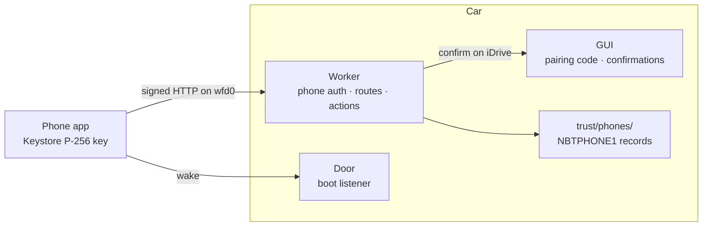

<!-- SPDX-License-Identifier: MPL-2.0 -->
# Phone access

A phone is accepted once: the car and the phone show the same six digits and the
driver confirms on iDrive. After that, package installs, updates and uninstalls
are requested with per-car P-256 signatures and confirmed on the car; declared
application settings apply without a confirmation. Packages come from files. A
phone can remember any number of cars; each car accepts four phones. The phone
never approves an action. The wire format is defined only in
[PROTOCOL.md](../PROTOCOL.md#paired-phone-http-protocol-1); the phone side is
`NBTFoundry/mobile-app`.

## Implementation

- `src/crypto/ec_public_key.cpp`: bounded P-256 SEC1 point import and canonical
  DER ECDSA verification through OpenSSL, beside the release and package RSA
  verifier.
- `src/storage/developer_store.cpp`, `src/package/signers.cpp`: up to eight
  developer keys (`NBTDEV1` records under `trust/developers/`) a phone adds or
  removes with the driver's confirmation, and the signer each application is
  bound to (PROTOCOL.md, "Developer keys").
- `src/storage/phone_store.cpp`: up to four private `NBTPHONE1` records under
  `trust/phones/<key-id>.conf` (name, key and pairing epoch), managed by path policy
  and atomic replacement. Removing a phone on the car revokes its next signed
  request.
- `src/worker/phone_auth.cpp`, `http_auth.cpp`, `phone_api.cpp`,
  `phone_actions.cpp`, `phone_routes.cpp`: a single-use nonce pool, the exact
  request digest, routes shared with the door, streaming upload staging and
  local-only, immutable action confirmations.
- `src/gui/phone_ui.cpp`, `phone_view.cpp`: waiting, the Wi-Fi pairing code, the
  six-digit confirmation, named uninstall and paired-phone management, with the
  refusal focused. Installs go through the digest-bound review, health check and
  rollback.
- `src/worker/door.cpp`, `src/launcher/door.cpp`: the door, a listener started from
  the known-good launcher at boot, with its own lifetime lock and readiness, `wfd0`
  retry and packet-filter label. Settings writes take the application's
  transaction lock.
- `plugin/phone_runtime.cpp`, `phone_display.cpp`, `src/gui/phone_wake.cpp`:
  periodic car-data reads, the fresh-speed rule, a bounded asynchronous layer query
  and the wake marker. The plugin stays STL-free and imports no heap allocator.

## Design

- Signed requests use uncompressed SEC1 keys and DER signatures in lowercase hex,
  bounded text replies and uint64 sequences, fixed in PROTOCOL.md and in the shared
  vectors (`tests/phone-signing-vectors.tsv`).
- **Opening the manager from the phone** is off. The wake rule allows it only on
  the ID6 home screen (context 3, `LT_Table_ID6L_Pad_Title`); navigation and other
  contexts answer busy (open by hand), and cameras and invalid contexts are
  refused.
- The framework's car-data add/get/remove calls and the UTF-16 callback delegate
  are confirmed against the shipped libraries; get and subscription share one
  callback map. Car data is polled, because subscription intervals are debounce
  limits, not periodic delivery.
- The phone app needs Nearby Wi-Fi on Android 13 and later and Fine Location on
  Android 10–12, for joining the car's Wi-Fi only; it uses no location and scans
  for no car.
- The door is a mode of the stable launcher (`--door`), so an installation gets it
  through Install or Update (`--refresh-setup`), not through a manager slot update
  alone.

## Tests

Host tests run the real worker and door with software phone keys: pairing and local
confirmations, signature and body tampering, replay, revoked and unknown keys, the
four-phone limit, symlink rejection, staging isolation, install rollback, first
install, settings, uninstall and the wake rule. Fuzz targets cover signatures,
pairing and wake contexts. The phone app's contract test
(`NBTFoundry/mobile-app: yarn test:contract`) runs its TypeScript protocol against
the same host worker and door.
